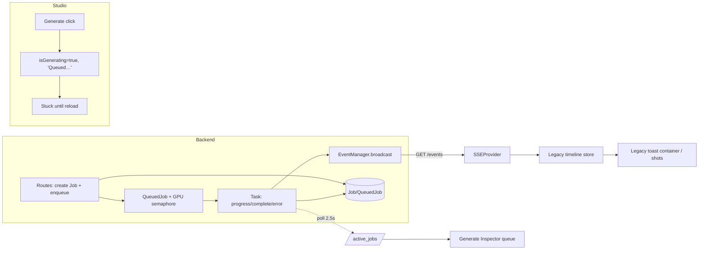

# Job Notifications Audit — 2026-11-17

## Verdict

Clicking **Generate** in Studio produces exactly one user-visible signal: the
button turns into a spinner. There is no queued notice, no stage, no progress, no
completion, no failure, and no cancellation notice.

This is not a missing backend event. It is a **disconnected notification plane**:

1. **Studio never renders toasts.** `addToast` writes to the Studio document store,
   but only the legacy shell (`App.tsx`) mounts a toast container, and the Studio
   route returns before it. 104 Studio call sites are silently swallowed.
2. **Studio never subscribes to SSE.** The global `SSEProvider` dispatches events
   into the **legacy** timeline store. Studio has no `EventSource` reference, so
   progress/completion/failure/cancel never reach a shot.
3. **The main generation flow has no fallback poll.** `useStudioGenerate` sets
   `isGenerating: true, statusMessage: 'Queued…'` and stops. Only the Generate
   surface's right-rail queue panel polls `/active_jobs` every 2.5 s; that list is
   not the shot, is not visible on other surfaces, and does not clear the shot on
   terminal state.

Everything else in the report follows from those three facts.

## Reproduction (empirical, 2026-11-17)

An unrelated real 121-frame job was already running during the probe (progress
52%, step 21/40 on `default`). A second job was submitted and stayed silent in the queue.

### 1. Studio probe (Playwright, temporary spec)

With `/generate/advanced` and `/batch-generate` stubbed to return a queued job:

```
batch toast visible after 1.2s: false
{"generating":1,"queuedToast":0,"completed":0,"anyStatusRole":0,
 "consoleLines":["[SSE] Connecting to /events...","[SSE] Connected!", ...]}
```

- `Queued 1 shot(s)` was added via `addToast`; nothing rendered.
- After Generate, the button stayed **Generating…** with no status role, no
  completion, and a 4 s wait produced no change.
- The console proves the SSE connection is open — and proves Studio does nothing
  with it.

### 2. SSE probe against the live backend

Listening on `GET /events` while a second job was submitted:

```
{"t":8.92,"event":"progress","data":{"job_id":"job_caa47cd3", ... "Generating (21/40)"}}
{"t":24.28,"event":"progress","data":{"job_id":"job_caa47cd3", ... "Generating (22/40)"}}
```

Nothing for the newly submitted `job_20c50b14`: no `queued`, no `started`, no
position, no ETA. Its `/status` said `pending` with `status_message: null`.

### 3. Cancel probe

`POST /jobs/job_20c50b14/cancel` (pending, not yet dispatched):

```
cancel  -> {"status":"cancelled"}
status  -> {"status":"cancelled","completed_at":null,"status_message":null}
queue   -> {"busy":true,"queued":1}
SSE     -> no event for that job (only the unrelated running job's progress)
```

The durable `QueuedJob` stayed `queued`; the queue position/estimate still count
it. `completed_at` was never set.

## How it works today



| Path | Emitter | Consumer | Result in Studio |
|---|---|---|---|
| Generation progress/complete/error | `job_utils.update_job_progress`, task broadcasts | Legacy store only | Invisible on the shot |
| Job admission / queue position | none | `/active_jobs` poll | Visible only in the Generate right rail |
| Cancel (running) | task broadcasts `cancelled` | legacy listener does not register it | Invisible; shot stays generating |
| Cancel (pending) | none | `/active_jobs` drops it eventually | Invisible; shot stays generating |
| AI parse | `ai_parse_complete/failed` | no listener; BoardCanvas polls `/status` | Blocking "Working…"; toast invisible |
| Depth / inpaint | events + `/status` | Edit polls | Inline text; toast invisible |
| Render / shorts | `render_progress` / `render_*` | Deliver/Shorts poll 4 s | Table updates only on those surfaces |
| Model downloads | `download_*` | legacy only; Studio has no interval | Visible only after **Rescan** |
| Setup / actions | `addToast` | **no renderer** | Silent |

## Gap register

### P0 — the reported failure

| ID | Gap | Evidence |
|---|---|---|
| **N-01** | Studio toasts are never rendered | `App.tsx` returns `<StudioApp/>` before the legacy toast container; 104 Studio `addToast` calls |
| **N-02** | Studio never consumes SSE | `SSEProvider` calls `useTimelineStore`; no `EventSource` anywhere under `src/studio` |
| **N-03** | Generate is optimistic-only | `useStudioGenerate` sets queued state and never reconciles progress/completion/failure/cancel |
| **N-04** | No queued/started event | Live probe: submitted job produced no SSE until it began denoising |
| **N-05** | Pending cancel is silent | Live probe: DB cancelled, queue still `queued`, no event, `completed_at` null |

### P1 — status is incomplete or unreachable

| ID | Gap | Evidence |
|---|---|---|
| **N-06** | Progress exists only as a button spinner | `shot.progress` is never updated; no bar, stage, ETA, or provider line |
| **N-07** | Job visibility is Generate-only | `useStudioActiveJobs` is called only in `GenerateSurface` (right rail); StatusStrip shows a 10 s health queue count |
| **N-08** | Reload loses the running state | persistence resets `isGenerating`; DB shot status is not set on generation start; no active-job resync |
| **N-09** | Cancel leaves the shot generating | `useStudioCancel` sets "Cancelling…" but never clears; no terminal event consumed |
| **N-10** | Async failures are invisible | failures after the HTTP 200 never clear `isGenerating` or show the error |
| **N-11** | Long stages report nothing | model load, conditioning encode, finalize/save emit no progress; only denoise steps do |
| **N-12** | Terminal events are not guaranteed | `run_queued_job` failure path, startup recovery, pause/resume and OOM retry broadcast no terminal/status event (OOM sends only `log`) |
| **N-13** | Progress is not persisted | `update_job_db` runs at start/terminal only; `/status` during a run is memory-only |
| **N-14** | Payloads are inconsistent | video/chained `complete` omit `shot_id`; progress has no `kind`/`stage`/`seq`/`ts`; errors have no stage or retryable flag |
| **N-15** | Even the legacy listener skips event types | `SSEProvider` never registers `cancelled`, `ai_parse_*`, `depth_*`, `download_queued`, `queue_updated`, `lora_updated`, `render_*`; `serverSlice`'s `cancelled` handler is unreachable |
| **N-16** | Queue metadata can lie | pending cancel leaves the `QueuedJob` row queued; startup-recovered jobs and OOM retries do not broadcast position changes |
| **N-17** | No tests | No SSE/event contract tests; no toast-rendering test; no reconnect test |

### P2 — consistency, accessibility, and reach

| ID | Gap | Evidence |
|---|---|---|
| **N-18** | No activity center or history | no global list of active/recent jobs, no retry from history |
| **N-19** | No OS/background notification | no Notification API/Tauri notification, no title/favicon progress, no sound |
| **N-20** | No accessibility for notices | no `role=status`/`aria-live` toast layer; progress is not announced; the probe found 0 status roles |
| **N-21** | Polling loops block surfaces | AI parse 300×2 s, inpaint 150×2 s, depth 120×1.5 s; no stage/progress beyond a busy label |
| **N-22** | Downloads have no live state in Studio | backend emits `download_*`; `useStudioModels` has no interval and Studio has no listener |
| **N-23** | Render/shorts completion is surface-local | 4 s poll only; no toast or background notice |
| **N-24** | No replay after reconnect | in-memory per-client queues, no event ids/`Last-Event-ID`; missed events are lost |
| **N-25** | Backpressure can drop terminal events | full queue drops the oldest message, with no terminal priority |
| **N-26** | Untyped events | SSE payloads are untyped and unchecked; no shared schema between backend and frontend |
| **N-27** | Event metrics absent | no SSE client count, delivery lag, dropped events, or queue-wait histogram |
| **N-28** | Stage vocabulary is free text | "Enhancing Prompt…", "Starting Generation...", "Finalizing & Saving..." are UI strings, not a stable machine state |

## Design: the job notification plane

**Principles**

1. **Every step has a name.** Admission → dispatch → load → enhance → condition →
   denoise → upscale → encode → save → terminal. A stage is data, not prose.
2. **Exactly one terminal event.** Completion/failure/cancel is emitted once by a
   single emitter, after the DB write, and includes the final state.
3. **The DB is the truth; events are the fast path.** `/status` and a resync
   endpoint can reconstruct any state after a reload, reconnect, or restart.
4. **One stream, many consumers.** A shared app-level event bus feeds the legacy
   and Studio stores; no surface opens its own EventSource.
5. **Notify at the edge.** Toasts for terminal states, inline progress where the
   work was started, a global activity indicator everywhere else.
6. **Accessible by default.** Polite live regions for progress, assertive for
   failure, no focus theft, keyboard dismissal, reduced-motion respected.
7. **Local-first.** No external notification service; OS notifications are opt-in.

**Event envelope (proposed)**

```json
{
  "seq": 1042,
  "ts": "2026-11-17T20:05:46.811Z",
  "event": "job.stage",
  "job_id": "job_20c50b14",
  "shot_id": "audit-shot-1",
  "project_id": "ce0d07fa",
  "kind": "video",
  "stage": "denoise",
  "progress": 52,
  "step": 21,
  "total": 40,
  "eta_seconds": 270,
  "message": "Denoising 21/40",
  "data": {"provider": "ollama", "model": "llama3.2:3b"}
}
```

**Event catalog**

| Event | When | Required fields |
|---|---|---|
| `job.queued` | admission; also on position change | position, estimate, kind, project/shot |
| `job.waiting` | blocked on memory or a priority queue | reason (`memory`/`queue`), position/estimate |
| `job.started` | worker takes the semaphore | kind, project/shot |
| `job.stage` | stage transition (load/enhance/condition/denoise/upscale/encode/save) | stage, progress floor |
| `job.progress` | throttled numeric updates (≥1 s or ≥2%) | progress, step/total, eta |
| `job.retrying` | OOM retry | new params, attempt |
| `job.cancelling` | cancel requested | requested_at |
| `job.completed` | after DB write | url, thumbnail, asset, frames, duration |
| `job.failed` | after DB write | stage, message, retryable |
| `job.cancelled` | after DB write | stage |
| `queue.paused` / `queue.resumed` | queue control | by, active job |
| `render.*`, `ai_parse.*`, `depth.*`, `download.*` | existing domains | keep, add `seq/ts` and `job_id` |

Legacy event names may be mapped from the new envelope during the transition so
the frozen editor keeps working.

**Client state model**

- `jobIndex: job_id → {shot_id, project_id, kind, lastEvent}` built from generate
  responses, `/active_jobs` (add `shot_id`), and project load.
- On `job.progress`/`stage`: update the shot (`isGenerating`, progress, stage,
  ETA, enhanced prompt) and the activity list.
- On terminal: clear generating, apply URL/thumbnail/frames, refresh takes/assets,
  toast once, remember in recent history.
- Resync on SSE open, reconnect, `visibilitychange`, `online`, and project switch:
  fetch `/active_jobs` and `/status/{id}` for any shot with `lastJobId`; clear
  stale spinners.
- Toast dedupe key: `{job_id}:{terminal}`; success auto-dismiss 6 s, failure 12 s,
  cancel 6 s.

## Implementation plan

### N0 — Stop the silence (P0, 0.5–1 day)

| Task | Change | Acceptance |
|---|---|---|
| N0-01 | `StudioToastLayer` in `StudioApp` (aria-live polite, `role=status`, dismiss, stacking, tone, 104 call sites immediately visible) | `Queued 1 shot(s)` appears in the probe |
| N0-02 | Shared event bus: one `EventSource`, typed handler registry; legacy adapter + Studio adapter | Studio receives `progress`/`complete`/`error`/`cancelled` |
| N0-03 | Studio reconciliation: map job→shot, update progress/stage/ETA, terminal clears + refreshes takes | Probe shows progress and completion without reload |
| N0-04 | Cancel/failure wake-up: clear on `job.cancelled`/`job.failed` and after a 5 s `/status` watchdog | Cancel clears the spinner in ≤5 s |
| N0-05 | Generate inline status under the shot: progress bar, stage text, provider/model, ETA | User sees "Queued → Enhancing → Loading → Denoising 21/40 → Saving" |

### N1 — Complete and truthful backend events (P0, 1–2 days)

| Task | Change | Acceptance |
|---|---|---|
| N1-01 | Typed event envelope + schema shared with the client; `seq`/`ts`/`shot_id`/`kind`/`stage` | Contract test validates every payload |
| N1-02 | Emit `job.queued` (position/estimate) and `job.started` in `enqueue_gpu_job`/`run_queued_job` | Live probe shows both before denoising |
| N1-03 | Stage events for load, enhance, condition, upscale, encode, save; progress floors | A fake pipeline emits every stage in order |
| N1-04 | One terminal emitter after the DB write; remove ad-hoc broadcasts; add `shot_id` to video/chained | Property test: exactly one terminal per job |
| N1-05 | Persist progress/stage/`started_at` (throttled ≥1 s) so `/status` survives reload/restart | `/status` mid-run returns the latest stage |
| N1-06 | Pending cancel: mark `QueuedJob` cancelled, set `completed_at`, broadcast `job.cancelled` | Queue no longer counts it; event arrives |
| N1-07 | Startup recovery and OOM retry broadcast `job.retrying`/`job.failed`/`job.queued` | Recovery is visible |
| N1-08 | Add `shot_id` to `/active_jobs` and queued rows | Studio can reconcile without guessing |
| N1-09 | Emit `job.waiting` for memory/queue waits and `memory.*` events for evictions/unloads | Waits and evictions are visible and explained |

### N2 — A global notification surface (P1, 1–2 days)

| Task | Change | Acceptance |
|---|---|---|
| N2-01 | Activity center in TopBar: active/queued/recent, stage/progress/ETA, project/shot, cancel/retry | Reachable from every surface |
| N2-02 | StatusStrip shows current stage/progress, not just a queue count | Always-on signal |
| N2-03 | Document title + favicon progress; unread badge | Background tab shows `42% · Milimo` |
| N2-04 | OS notification (Tauri/Notification API) opt-in when hidden | Permission flow + fallback |
| N2-05 | Preferences: toasts, OS, sound, per-project mute | Persisted locally |

### N3 — Every async surface (P1, 1–2 days)

| Task | Change | Acceptance |
|---|---|---|
| N3-01 | AI parse consumes `ai_parse_*` + stage events; remove the blocking 300×2 s loop | Board shows parse stages; failure toast |
| N3-02 | Depth and inpaint consume `depth_*`/progress; no blocking loop | Stage text + terminal toast |
| N3-03 | Renders/Shorts consume `render_*`; completion toast + history | Works off-surface |
| N3-04 | Model downloads consume `download_*` with live bars and a cancel | Setup updates without Rescan |
| N3-05 | Element visual generation reports its own job | Story/Setup show progress |

### N4 — Reliability (P1, 1 day)

| Task | Change | Acceptance |
|---|---|---|
| N4-01 | Ring-buffer replay with `id:`/`Last-Event-ID`; terminal events never dropped | Disconnect test delivers missed events |
| N4-02 | Resync on reconnect/visibility/online/project switch | Reload mid-job restores state |
| N4-03 | Stale-spinner watchdog on project load | No permanent "Generating…" |
| N4-04 | Metrics: clients, delivery lag, dropped events, queue-wait histogram | `/metrics/jobs` extended |
| N4-05 | Contract + Playwright fake-SSE tests; axe live-region test | CI green |

### N5 — Polish (optional)

Sound cue, recent-job history with retry, per-stage timing (ETA model), desktop
tray progress, local webhook for automations.

## Verification

- **Backend:** fake task emits the full stage sequence; assert order, required
  fields, exactly one terminal, pending-cancel queue cleanup, OOM retry events,
  replay by `Last-Event-ID`.
- **Frontend:** Vitest toast rendering + reducer tests; Playwright with a fake SSE
  server asserts queued → loading → denoise → complete, reload resync, cancel,
  failure, and dedupe.
- **Accessibility:** axe on Generate and Setup; `role=status` present; no focus
  theft; keyboard dismissal.
- **Live:** submit a job with a real engine, kill/reconnect the stream mid-run,
  reload the page, cancel a queued job, and confirm the state converges.

## Do not do

- Do not emit a toast for every denoise step; progress belongs inline, terminals
  belong in toasts.
- Do not rely on SSE alone; keep the DB/status resync.
- Do not open a second EventSource per surface.
- Do not let each task invent its own terminal broadcast; one emitter.
- Do not use OS notifications without explicit permission.
- Do not expose raw backend strings as the stage vocabulary.

## Implementation status (2026-11-17)

N0, N1, N2, N3, and the core of N4 landed. N5 remains optional.

| Task | Status | Evidence |
|---|---|---|
| N0-01 toast layer | **Done** | `StudioToastLayer` mounted in `StudioApp`, aria-live, tone, dismiss, max 5 |
| N0-02 shared SSE bus | **Done** | one `SSEProvider`; typed `job.*` handlers + legacy mapping + system handlers |
| N0-03 job→shot reconciliation | **Done** | `jobBridge.ts` updates shot stage/progress/ETA/take; `/active_jobs` resync |
| N0-04 cancel/failure wake-up | **Done** | terminal events clear state; `useStudioCancel` 5 s `/status` watchdog |
| N0-05 inline generate status | **Done** | Generate surface bar with stage label, percent, ETA, message |
| N1-01 typed envelope | **Done** | `{ts,event,job_id,shot_id,project_id,kind,stage,progress,step,total,eta_seconds,message}` |
| N1-02 queued/started | **Done** | `enqueue_gpu_job` emits position + estimate; `run_queued_job` emits started |
| N1-03 stage events | **Done** | enhancing, loading, conditioning, denoising, upscaling, inpainting, encoding, saving |
| N1-04 one terminal emitter | **Done** | `job_events.terminal` writes the DB once and emits once; duplicates ignored |
| N1-05 persist progress | **Done** | throttled ≥1 s, stage change forces a write; `/status` returns stage/memory |
| N1-06 pending cancel | **Done** | cancels `Job` + `QueuedJob`, emits `job.cancelled` |
| N1-07 recovery/OOM events | **Done** | `job.retrying`, `job.failed` on recovery, `job.queued` on re-dispatch |
| N1-08 shot_id in active rows | **Done** | `/active_jobs` includes shot/kind/stage/step/eta/started_at |
| N1-09 memory waits/events | **Done** | `job.waiting`, `memory.pressure`, `memory.evicted`, `queue.paused/resumed` |
| N2-01 activity center | **Done** | TopBar popover: active rows with bar/ETA/cancel, recent history, unread badge |
| N2-02 status strip | **Done** | current stage + percent + ETA, falls back to queue count |
| N2-03 title progress | **Done** | document title shows `% · stage · Milimo` while busy |
| N2-04 OS notification | **Done** | browser Notification on hidden tabs when granted; the Tauri shell adds a `notify` command using macOS Notification Center via `osascript`, so desktop builds do not depend on the browser permission |
| N2-05 preferences | **Done** | persisted `milimo-studio-notifications` (toasts/os/sound) with a Setup panel; per-project mute is not included |
| N3-01 AI parse | **Done** | stage + terminal events; no blocking poll loop in Studio |
| N3-02 depth/inpaint | **Done** | stage + terminal events |
| N3-03 renders/shorts | **Done** | `render_*` toasts + Deliver refresh |
| N3-04 downloads | **Done** | `download_*` refresh models; polling only while a download is active |
| N3-05 element visual | **Done** | element jobs now have a `Job` row and emit stage/terminal |
| N4-01 replay | **Done** | `seq` ids + `Last-Event-ID`/`last_event_id` replay, 120 s window |
| N4-02 resync | **Done** | reconnect dispatches `milimo:resync`; active-job and takes/assets/renders hooks listen |
| N4-03 stale spinner watchdog | **Done** | reconcile against `/status` on mount/resync; cancel watchdog |
| N4-04 metrics | **Partial** | `clients`, `sequence`, `replay_buffer`, memory peak exposed; delivery lag/histogram not aggregated |
| N4-05 tests | **Done** | `tests/test_job_events.py` (17), `jobBridge.test.tsx` (6), `JobProgressUi.test.tsx` (6), `generatePreflight.test.ts` (3), `bootstrap.test.ts` (2) |

### Live probe (2026-11-17)

Connected an SSE client to `/events` and drove real jobs:

```
job.queued   {"stage": "queued",  "message": "Queued (#1)"}
job.started  {"stage": "starting","message": "Starting video job…"}
job.stage    {"stage": "loading", "progress": 2, "message": "Loading ti2vid pipeline…"}
job.stage    {"stage": "conditioning", "progress": 8, "message": "Pipeline ready"}
job.stage    {"stage": "denoising", "progress": 10, "message": "Starting generation…"}
```

Queued-then-cancelled probe:

```
job.queued    {"stage": "queued",    "message": "Queued (#1)"}
job.waiting   {"stage": "waiting",   "message": "GPU queue is paused; waiting for resume"}
job.cancelled {"stage": "cancelled", "message": "Cancelled before start"}
```

`/status/{job_id}` returned `cancelled`/`cancelled`, and `/active_jobs` no longer
listed it. A cancelled 121f denoise converged to `cancelled` at progress 11 with
no OOM.

### N5 polish (implemented)

- Sound cue (WebAudio, off by default) and opt-in desktop notifications.
- Recent-job history has a per-row **Retry** that re-queues the job's shot.
- ETA is derived per stage from the observed step rate when the task does not
  provide one.
- Optional terminal webhook: `MILIMO_JOB_WEBHOOK` (+ `MILIMO_JOB_WEBHOOK_TOKEN`),
  posted in a daemon thread after the terminal event, local-first and off by
  default.
- Desktop window title tracks `% · stage` through a `set_window_title` Tauri
  command; the browser tab title is always updated.
- Per-project notification mute is persisted alongside toasts/OS/sound.
- The macOS dock badge shows the current progress percent (and the active job count)
  through a Tauri `set_badge` command, cleared when the queue is idle.

### Known limits

- The legacy `/` editor still receives mapped `progress/complete/error/cancelled`
  events; it does not render Studio toasts.
- Desktop notifications on macOS call `osascript`; other platforms return an
  error and fall back to the in-app surface. Sound uses WebAudio and is off by
  default.
- A cancelled job keeps its loaded pipeline until the 300 s idle TTL unless
  `Release all` is used.
- Non-stream LLM cancellation cancels the in-flight task and closes the socket.

## Open questions

- Should progress be per-denoise-step or time-throttled at 1 s? (Current step
  cadence is 15 s on the reference machine, so step events are already sparse.)
- OS notifications: web Notification API vs Tauri plugin vs both?
- Should the activity center persist across projects or be project-scoped?
- Do we keep legacy event names forever or migrate the frozen editor once?

## Related

- [[sse-eventing.md]] — transport and current event catalog
- [[studio-shell.md]] — Studio surfaces that need the signal
- [[frontend-state.md]] — stores that own the state
- [[../roadmap/implementation-plan-2026-11.md]] — phased delivery
