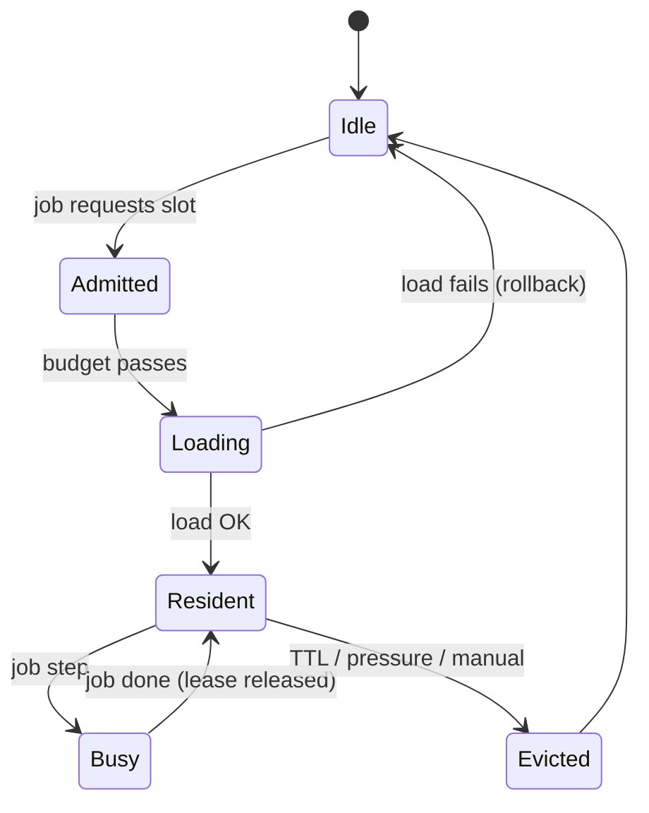

# Memory Management Audit — 2026-11-17

## Verdict

Milimo has **model slots**, not a memory system. It knows which slot is hot; it
does not know how many bytes anything costs, what external engines are holding, or
how close the machine is to dying.

On this 128 GB machine, a 121-frame, 768×512, 40-step video with upscaling ran
while **Strata held 33 GB** and **oMLX held 6.5 GB** of model memory that Milimo
could not see or release. The LTX pipeline needs ~76 GB. The arithmetic exceeds the
machine's 115 GB MPS ceiling before macOS, Docker, Safari, or the editor are
counted. Swap filled to 96%, macOS showed “Your system has run out of application
memory,” the generation worker died, and the backend was left wedged.

The fix is not one number. It is a residency system: measured budget, model costs,
admission control, engine-aware unload, idle eviction, pressure response, and
observability.

## Incident evidence (2026-11-17, ~13:59–14:16 CST)

| Observation | Value |
|---|---|
| Hardware | Mac15,9, 16 cores, **137.4 GB** unified memory (128 GiB) |
| MPS recommended working set | **115.4 GB** (`torch.mps.recommended_max_memory()`) |
| Swap | 44.0 GB total, **40.3–42.2 GB used (92–96%)** |
| Job | `job_caa47cd3`, 121 frames, 768×512, 40 steps, cfg 3.0, **upscale=true**, enhance=true |
| Denoise | 40 steps in **9:51** (~14.9 s/step) |
| Upscale phase A | 3 steps in **1:52** (~37 s/step) |
| Upscale phase B | 3 steps in **0:53** |
| OOM dialog | ~14:16, after the upscale phases, during finalize/encode |
| Second pass | The log shows a second 40-step pass at faster step times after the first, consistent with the automatic OOM retry (75% resolution/frames) |
| Backend after the incident | HTTP timed out; parent process 349 MB at 91% CPU; no model process alive; job stuck `processing` |
| Foreign residency | **Strata 33 GB** (31 GB IOAccelerator), **oMLX 6.5 GB** (6.1 GB IOAccelerator); Ollama 0 |
| Backend model memory before death | LTX ~76 GB budget (40 GB checkpoint + 23 GB Gemma + VAE/upscalers/workspace) |

The sum at peak — 39.5 GB foreign + ~76 GB LTX + macOS/Docker/Safari — is above
the 115.4 GB MPS ceiling. The machine did not fail to allocate one tensor; it ran
out of *system* memory and swapped to death.

**Recovery exercised while writing this audit:** the orphaned `QueuedJob` was
marked failed manually (otherwise recovery would relaunch it, M-28), oMLX's 6.3 GB
Llama was unloaded through `/v1/models/.../unload`, and the backend was restarted.
`/health` returned OK with an empty slot list and queue, and the job was closed as
`failed: Server restarted while the job was running`. Studio reconnected.

## Model inventory (measured on disk / documented runtime)

| Component | Weights on disk | Runtime estimate | Loaded by | Owned by |
|---|---|---|---|---|
| LTX-2 19B distilled | **40 GB** | **~76 GB** incl. Gemma + VAE + upscalers | `model_engine.ModelManager` | in-process `video` slot |
| Gemma 3 text encoder | **23 GB** | included above | LTX pipeline | in-process `video` slot |
| Flux 2 Klein 9B | **17 GB** | **~36 GB** incl. Qwen3 encoder, AE, CLIP, IP-Adapter | `FluxInpainter` | in-process `image` slot |
| SAM 3 | 3.2 GB | ~6–8 GB | separate microservice | `sam3` process |
| Depth Anything V2 Small | ~0.1 GB | ~0.5 GB | `tasks/depth.py` | in-process, **no slot** |
| Ollama model | model-dependent | 2–40 GB | Ollama process | **external, unmanaged** |
| oMLX model | model-dependent | measured 6.34 GB (Llama 3B) | oMLX process | **external, unmanaged** |
| Strata engine | model-dependent | measured 33 GB | Strata process | **external, unmanaged** |

## Current control plane

```mermaid
flowchart TD
    API[Generate / activate / warm] --> SEM[asyncio GPU semaphore]
    SEM --> TASK[task]
    TASK --> MM[MemoryManager.prepare_for(slot)]
    MM -->|unload conflicts| LTX[LTX pipeline]
    MM -->|unload conflicts| FLUX[Flux pipeline]
    TASK --> LOAD[ModelManager / FluxInpainter]
    LOAD --> CHECK[model_loader.can_load_model: static 40/24 GB vs psutil.available]
    EXT[Ollama / oMLX / Strata] -.->|invisible| MM
```

| Piece | What it does | What it cannot do |
|---|---|---|
| `MemoryManager` | Named slots (`video`, `image`, `llm_http`); unloads conflicts; flushes caches | No byte accounting, no budget, no idle TTL, no pressure response, no SAM/depth slot |
| `model_loader.can_load_model` | Compares `VRAM_ESTIMATE_VIDEO_GB=40` / `IMAGE=24` × 1.2 to `psutil.available` | Estimates are **half or less** of real peaks; ignores text encoder, upscalers, workspace, external engines, swap, and pressure |
| `ModelManager.load_pipeline` | One cached LTX pipeline; unloads the old one first; `prepare_for("video")` | No admission estimate; no rollback on failed load; holds LTX resident forever after a job |
| `FluxInpainter` | One Flux singleton; `prepare_for("image")` | Same: no budget, no TTL, can unload LTX from a route |
| `job_utils` | Durable queue + one global GPU semaphore for all heavy jobs | No priority, no model-aware batching, no memory-aware admission, no "waiting for memory" state |
| LLM plane | `release_local()` unloads **Ollama** role models after enhancement | oMLX/Strata remain warm; no query of their resident bytes; no unload adapter; warm/eval can leave models loaded |

## Findings

### P0 — causes and amplifiers of the incident

| ID | Finding | Evidence |
|---|---|---|
| **M-01** | **Static estimates are wrong.** Video is checked at 40 GB; the checkpoint alone is 40 GB and the pipeline needs ~76 GB with Gemma/VAE/upscalers. Image is checked at 24 GB; Flux needs ~36 GB. | `config.py`; model files; `model_loader.can_load_model` |
| **M-02** | **Peak, not base, must be budgeted.** Upscaling adds two 3-step phases at higher resolution; decode/encode allocate the full video. The 40 GB check passed at 110 GB “available” while the job's peak was over the ceiling. | 3-step phases at 37 s/step; OOM during finalize |
| **M-03** | **External engines are invisible.** Strata 33 GB + oMLX 6.5 GB were resident; Milimo has no query and no unload for either. | `footprint`; oMLX `/v1/models/status`; `/health` |
| **M-04** | **Activation bypasses the job serialization.** `/models/{id}/activate` and `/deactivate` load/unload pipelines directly, with no semaphore or job lease. A click can unload LTX during a video job. | `routes/models.py`, `model_loader.activate_base_model` |
| **M-05** | **No idle eviction.** LTX/Flux stay resident after a job until another slot needs memory. On a 128 GB machine, 76 GB held indefinitely is a system-wide OOM waiting for the next app. | `MemoryManager` only evicts on conflict |
| **M-06** | **No pressure or swap guard.** The machine was at 96% swap and still accepted the job; `psutil.available` looks healthy under compression. | `vm.swapusage`, `psutil.swap_memory` |
| **M-07** | **No MPS cap.** PyTorch may allocate until macOS thrashes. `torch.mps.set_per_process_memory_fraction` is available and unused. | API probe |
| **M-08** | **Blocking finalize.** `encode_video` (and parts of save) run on the event loop; `/health` and SSE stop responding for minutes, which also hides progress. | HTTP timeouts during finalize |
| **M-09** | **Crash leaves an orphan.** After the worker died, the reloader parent spun at 91% CPU with no model; the Job/QueuedJob stayed `processing/running`, and the studio stayed dead. | process/footprint probe; DB |
| **M-26** | **The OOM retry is a memory amplifier.** On OOM the queue retries once at 75% resolution/frames, but keeps `upscale=true`, performs no new budget check, and emits only a `log` event. The retry re-runs the full pipeline (~10 more minutes) at a still-too-high peak and is invisible in the UI. | `job_utils._oom_retry_params`; second 40-step pass in the log |
| **M-10** | **Upscale has no budget warning.** `upscale=true` is a 2× resolution phase; the UI shows a checkbox, not a cost. For 121 frames on this machine it is the difference between fitting and OOM. | Job params; shot/UI |

### P1 — incomplete residency model

| ID | Finding | Evidence |
|---|---|---|
| **M-11** | SAM 3 and Depth have no slots; their residency is not in `status()` or the budget. | `memory_manager.py`; `tasks/depth.py` |
| **M-12** | No model cost registry: no per-checkpoint bytes, text-encoder cost, upscaler cost, or workspace model. | estimates are two constants |
| **M-13** | No load rollback: a failed LTX/Flux load leaves the slot marked active and the previous model gone. | `prepare_for` marks before load |
| **M-14** | No "keep warm" / TTL policy per slot; no manual unload-all; no per-model unload outside activation routes. | `MemoryManager` API |
| **M-15** | No model-aware scheduling: a batch of thumbnails can force Flux↔LTX thrash before a user's video. | queue order only |
| **M-16** | No memory-aware admission: no “waiting for memory”, no downgrade proposal (fewer frames, no upscale), no refusal with a reason. | job start path |
| **M-17** | Warm/eval leaves LLM models loaded (oMLX 6.34 GB actual), and only Ollama can be released. | `release_local`; oMLX status |
| **M-18** | No peak sampler, no per-stage memory timeline, no OOM postmortem in the job record. | `/health` has slot names only |
| **M-19** | `psutil.available` is not a fit test on macOS: inactive/purgeable pages and compressed memory blur “free”, while swap is already 96%. | system probe |

### P2 — observability and tuning

| ID | Finding |
|---|---|
| **M-20** | `/health` reports slot names, queue, disk — not bytes, swap, pressure, or external engines. |
| **M-21** | No memory metrics (peak, load time, evictions, refusals) in `/metrics/jobs`. |
| **M-22** | No preflight UI: the user cannot see the estimated peak, what will be unloaded, or why a job would fail. |
| **M-23** | No engine-specific unload UX for oMLX (available), Strata (opaque), or LM Studio/vLLM (unknown). |
| **M-24** | No "quiet mode" for background jobs (thumbnails, element visuals) that defers heavy work while the user is editing. |
| **M-25** | No supervisor health check: a crashed worker is not restarted and the orphaned job is not failed until a restart. |
| **M-27** | Generation logs are missing from `server.log` and the shell shows only uvicorn/tqdm output; there is no per-stage log or memory trace to postmortem a crash. |
| **M-29** | **The reloader burns a core.** `server.py` runs uvicorn with `reload=True` against the repo root, so the parent scans the 40 GB model directories continuously (`os_scandir` at ~90% CPU). This is constant, not incident-specific, and makes crash triage misleading. | `sample` of the reloader; process tree |
| **M-28** | **Recovery can re-run the OOM job.** `resume_queued_jobs` re-queues every `running` QueuedJob with fewer than two attempts, and `generate_video_task` only checks for `cancelled` — not the Job status. Restarting after a memory kill can immediately launch the same 121-frame job again. | `job_utils.resume_queued_jobs`; task start check |

## Engine residency adapters (what is actually available)

| Engine | Status query | Unload | Notes |
|---|---|---|---|
| **Ollama** | `GET /api/ps` (`size`, `size_vram`) | `POST /api/generate {keep_alive: 0}` | already used by `providers.unload` |
| **oMLX** | `GET /v1/models/status` → `current_model_memory`, per-model `loaded`, `resident_estimated_size`, `actual_size`; `GET /health` → `final_ceiling`, `current_model_memory` | `POST /v1/models/{model}/unload` (also `/admin/api/models/{model}/unload`) | fully integrable; measured 6.34 GB for Llama 3B |
| **Strata** | `GET /v1/models` lists the served model; its control API at `:47831/api/health` reports the supervised engine stopped while the engine on `:18500` is live and holds 33 GB | none documented; quitting the app/engine is the only lever found | treat as externally managed; budget it, warn, never assume release |
| **LM Studio** | `/v1/models` (and optional `/api/v0/models` state) | CLI/process dependent | optional adapter; estimate if unknown |
| **vLLM / llama.cpp** | `/v1/models` | none standard | process-level only |
| **Gemma (in-process)** | owned by LTX pipeline | pipeline unload | part of the 76 GB video budget |

This is the key design input: **some engines can be asked, some can be told, one is
opaque.** The budget must include all of them; unload is best-effort per adapter.

## Design: a memory budget and residency system

**Principles**

1. **Budget bytes, not slot names.** Every load states a cost; every slot reports a
   resident cost; the budget is explicit.
2. **Peak, not average.** Estimate the maximum over the job's phases (denoise,
   upscale, decode, encode) and reserve headroom for the OS.
3. **Ask the engines.** Query Ollama/oMLX/Strata for residency; include it in the
   budget. Unload when the adapter supports it; warn when it does not.
4. **Admission before allocation.** Refuse or downgrade before touching memory, with
   a message the filmmaker can act on (“unload Strata, or render 81 frames without
   upscale”).
5. **Idle is a cost.** Evict idle models on a TTL and under pressure; never keep 76 GB
   warm by accident.
6. **Never unload under a live job.** Activation, deactivation, and eviction must
   acquire the same job lease as generation.
7. **Observe the truth.** Sample MPS allocation per stage, store peaks, expose them,
   and use them to calibrate the estimator.
8. **Local-first.** No cloud memory service; everything is measured on the machine.

### Budget model

```
total        = psutil.virtual_memory().total                    # 137.4 GB
reserve      = max(MILIMO_MEMORY_RESERVE_GB, total * 0.15)      # OS + apps
mps_ceiling  = torch.mps.recommended_max_memory()                # 115.4 GB
in_process   = torch.mps.driver_allocated_memory()               # this backend
external     = sum(engine adapters' resident bytes)              # 39.5 GB today
swap_used    = psutil.swap_memory().used                         # 42 GB today

available_for_new = min(mps_ceiling, total - reserve)
                    - in_process - external
```

A load is admitted only if `estimated_peak(model, job) + safety <= available_for_new`
and `swap_used < swap_limit` and the pressure level is not critical.

### Cost registry

| Cost | Source |
|---|---|
| Weights | actual safetensors/GGUF file sizes |
| Text encoder | file sizes + dtype factor (Gemma 23 GB, Qwen3 ~16 GB) |
| VAE | float32 factor for MPS |
| Upscalers | file sizes (spatial/temporal) |
| Attention/activation workspace | calibrated per `(frames, width, height, steps)` from the sampler; conservative fallback |
| Phase multipliers | denoise 1.0, upscale 1.6–2.0, decode/encode 1.2 |
| External LLM | adapter-reported resident bytes; declared fallback |

### Lifecycle



Admission is a lease: `acquire(slot, model, cost, job_id)` holds a refcount and
blocks eviction; `release` decrements; idle timers only fire at zero.

## Implementation plan

### M0 — Stop the next OOM (P0, 2 days)

| Task | Change | Acceptance |
|---|---|---|
| M0-01 | `MemoryBudget` service with total/reserve/ceiling/swap/pressure/in-process/external; expose in `/health` | Health shows real bytes and the external total |
| M0-02 | Model cost registry + job peak estimator (frames, resolution, steps, upscale) | A 121f/768×512/upscale job is refused or downgraded on this machine |
| M0-03 | Engine adapters: Ollama `/api/ps`, oMLX `/v1/models/status`, Strata best-effort; include in budget | 39.5 GB is visible before a load |
| M0-04 | Admission at every heavy entry: enqueue, activate, warm, eval; actionable refusal | No heavy load can bypass the budget |
| M0-05 | Guard activation/deactivation with the GPU job lease | Activating Flux during a video job is refused |
| M0-06 | Move `encode_video`/save off the event loop; keep `/health` and SSE alive | Health responds during finalize |
| M0-07 | `torch.mps.set_per_process_memory_fraction` safety cap + swap guard | PyTorch fails before macOS thrashes |
| M0-08 | Supervisor: no reload in normal runs (or watch only source dirs); on worker death mark active jobs failed and restart | Parent does not burn a core; crash leaves no orphan `processing` job |
| M0-09 | Upscale warning/estimate; default off for long jobs under budget pressure | UI shows the cost before the job starts |
| M0-10 | Budget-aware OOM retry: release external engines, re-estimate, reduce upscale, emit `job.retrying`; refuse if still too large | Retry cannot OOM twice; the retry is visible |
| M0-11 | Per-stage job logging + memory sample in the job record | A crash has a readable postmortem |
| M0-12 | Reconcile Job/QueuedJob on recovery; never re-run a failed/cancelled or memory-killed job without fresh admission | Restart cannot relaunch an OOM job |

### M1 — Residency and eviction (P0/P1, 2 days)

| Task | Change | Acceptance |
|---|---|---|
| M1-01 | Extend `MemoryManager` to a residency manager: slots with model, bytes, lease, last_used, `keep_warm` | `status()` returns bytes, not just names |
| M1-02 | Idle TTL per slot (video/image 5 min, llm 2 min, sam 10 min), configurable | Idle LTX releases after TTL |
| M1-03 | Pressure watcher (`kern.memorystatus_vm_pressure_level`, swap %, available); warn/critical actions | Pressure evicts idle models and pauses admission |
| M1-04 | Eviction order and manual unload-all; never evict a leased slot | Manual unload works; active job safe |
| M1-05 | Rollback on load failure; mark slot only after success | Failed load leaves a clean state |
| M1-06 | Per-engine unload UI (oMLX yes, Ollama yes, Strata warn, others estimate) | Setup shows and releases what it can |
| M1-07 | Tests: fake engines, budget math, lease/evict, pressure, rollback | Deterministic, no GPU |

### M2 — Scheduling and batching (P1, 1–2 days)

| Task | Change | Acceptance |
|---|---|---|
| M2-01 | Priority queue: interactive generation > batch thumbnails/elements > background parse | A user job is not stuck behind 20 thumbnails |
| M2-02 | Model-aware batching: group same-slot jobs to avoid Flux↔LTX thrash | Mixed batch has ≤ N model swaps |
| M2-03 | “Waiting for memory” state with reason/ETA; notification event | Queue shows why it waits |
| M2-04 | Downgrade proposal (frames/resolution/upscale) instead of a flat refusal | User can accept a safe preset |
| M2-05 | Cancel in upscale/finalize phases | Cancel converges without a model swap |

### M3 — Observability and UX (P1, 2 days)

| Task | Change | Acceptance |
|---|---|---|
| M3-01 | Setup memory panel: budget bar, per-slot cost/last used, external engines, unload buttons | The 39.5 GB is visible and actionable |
| M3-02 | Generate preflight: estimated peak, current residency, what will be unloaded, upscale cost | Confirm only when tight |
| M3-03 | Per-job memory sampler (1 s), peak per stage, swap delta, stored in `params_json.memory` | Postmortem after a failure |
| M3-04 | Metrics: peak, load time, evictions, refusals, queue wait | `/metrics/jobs` extension |
| M3-05 | Notifications for “unloading Flux”, “waiting for memory”, “memory critical” | Ties into the N0/N1 event plane |

### M4 — MPS hardening (P1, 1 day)

| Task | Change | Acceptance |
|---|---|---|
| M4-01 | Cap MPS allocation at `min(0.85, (total-reserve)/total)`; handle MPS OOM cleanly | No system-wide thrash from one job |
| M4-02 | Tiled/chunked VAE decode/encode for all paths; avoid duplicate full-video buffers | Peak drops on 121f jobs |
| M4-03 | Peak-aware resolution/frames clamp before load; upscale as a separate job | Refuse before allocation |
| M4-04 | Cache flush + autorelease after unload; verify footprint drops | Measured release |

### M5 — Model efficiency (P2, optional)

Smaller/quantized checkpoints, distilled variants, MLX for LLMs, text-encoder
alternatives, SAM 3 lazy load, and a quality/memory/time comparison per model.

## Gates

- **G-M1:** On this machine, a 121f/768×512/upscale job with Strata + oMLX resident
  is refused or downgraded with a message naming the 39.5 GB and the options.
- **G-M2:** Any admitted job keeps peak ≤ budget and never drives swap past the
  limit (sampler evidence).
- **G-M3:** Activating/deactivating a model during a job is refused; no mid-job
  unload.
- **G-M4:** Idle LTX/Flux/LLM evicts after TTL; a pressure warning evicts idle
  models immediately.
- **G-M5:** `/health` and SSE respond during upscale and finalize.
- **G-M6:** A killed worker leaves no orphan `processing` job and the supervisor
  recovers.
- **G-M7:** A 10-job mixed batch performs no more than the configured model swaps.

## Immediate mitigations (before the code lands)

1. **Restart the backend carefully.** It is wedged (HTTP timeouts, 91% CPU parent,
   no model process). Before restarting, mark the orphaned `QueuedJob` failed:
   startup recovery would otherwise re-queue the same 121-frame job and can OOM
   again (M-28). The Job row is failed by startup cleanup.
2. **Release Strata** (33 GB) unless in use, or quit the app for long video jobs.
3. **Unload oMLX models** (6.3 GB) — `/v1/models/Llama-3.2-3B-Instruct-bf16/unload`
   works today; the panel does not call it yet.
4. **Turn off upscale** for 121-frame jobs on this machine; 81 frames or 640×384
   without upscale is a safer first test.
5. **Quit Docker/Safari during a long render**; the Kubona stack alone is ~2.7 GB.
6. **Watch swap**, not just “free”: `sysctl vm.swapusage`; if used > 20 GB, release
   models first.

## Verification recipe

- Fake engine servers returning known resident bytes; assert the budget includes
  them and refuses correctly.
- Unit-test the peak estimator against recorded stage peaks from a real 81f and
  121f run.
- Playwright: preflight dialog, memory panel, unload button, refusal message.
- Live: start a job with an external model loaded; confirm it unloads or refuses;
  sample peak; kill the worker mid-job; confirm recovery.

## Open questions

- What is the exact per-stage peak for 121f/768×512/upscale on this machine? The
  sampler in M3-03 will replace estimates with measurements.
- Does Strata expose any unload/stop endpoint from its native instance? The control
  API at `:47831` reports a different (stopped) engine than the live `:18500` one.
- Should “keep warm” default on for LTX on 128 GB machines? Proposal: 5-minute TTL,
  explicit pin.
- Should the app reserve memory for the editor/browser, or rely on the OS reserve?
  Proposal: reserve 15% + configurable floor.

## Related

- [[../concepts/memory-slots.md]] — slot rules and prior audit notes
- [[job-notifications-audit-2026-11.md]] — memory waits/evictions must be events
- [[llm-local-first-next-2026-11.md]] — engine residency adapters
- [[architecture.md]] — scheduler and model lifecycle in context
- [[../roadmap/implementation-plan-2026-11.md]] — M0–M5 delivery
