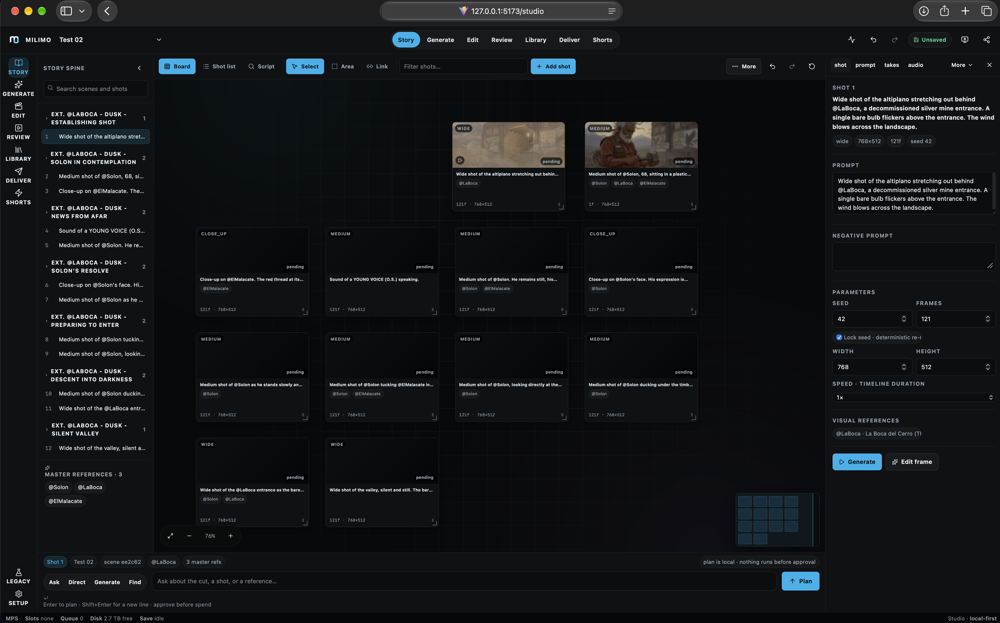

# Milimo Video

<div align="center">


**Local-first AI film studio — storyboard, generate, edit, review, deliver.**

[](LICENSE)
[](web-app/)
[](backend/)
[](https://github.com/Lightricks/LTX-2)

</div>

Milimo Video is an open-source, local-first studio for AI filmmaking. One project
carries the story, generated shots, a magnetic timeline, review notes, and the
final render. Models, media, jobs, and exports stay on your machine; no cloud
account is required.

The current shell is **Studio** at `/studio`. The original NLE remains at `/` as a
frozen fallback during the cutover.

```bash
./run_backend.sh     # FastAPI on http://127.0.0.1:8000
./run_frontend.sh    # Studio on http://127.0.0.1:5173/studio
```

## Studio

| Surface | What it does |
|---|---|
| **Story** | Script parsing, scene spine, infinite board, shot list, notes, master references, typed links, review cards, undo |
| **Generate** | Ingredients and `@trigger` mentions, seed lock, start/end conditioning, preview stills, batch queue/matrix, immutable takes, inpaint, pipeline recipes, optional ComfyUI workflows |
| **Edit** | Program monitor, compare/wipe, magnetic V1 with crossfades, free V2/A1/A2, clip thumbnails, trim/slip/roll/blade/ripple/rate/slide, waveforms, captions, keyframes, titles, depth overlay, tracking, blocking, 3D previz |
| **Review** | Frame comments, approvals, activity, compare, share links, agent plans |
| **Library** | Uploads, master references, takes, local ranked search, global media preview, per-asset **Delete** (file + poster) |
| **Deliver** | V1/V2 composite, A1/A2 mix, captions, titles, 3D LUT, encoding controls, render history/cancel, OTIO/FCPXML handoff |
| **Shorts** | Scored candidate windows, editable ranges, 9:16 / 1:1 / 4:5 export |
| **Setup** | Device/memory/queue/disk state, model downloads, LoRA activation, depth model, integrity scan, error budget, LLM roles, optional ComfyUI bridge |

### Studio preview

| Story | Edit |
|---|---|
|  |  |

## Engines

| Lane | Engine |
|---|---|
| **Video** | LTX-2 19B (`ti2vid`, `ic_lora`, `keyframe`, chained) |
| **Video upgrade** | LTX-2.5 22B (`pipeline_override=ltx25`, gated diffusers weights; adapter and local MPS run verified) |
| **Low-VRAM video** | Wan 2.2 TI2V-5B (`pipeline_override=wan`) |
| **Image** | Flux 2 Klein 9B — IP-Adapter, True CFG, RePaint inpainting, optional Q4_K_M GGUF |
| **Segmentation** | SAM 3 microservice — text/box/click masks and video tracking |
| **Depth** | Depth Anything V2 Small (optional, downloaded in Setup) |
| **Text / LLM** | Gemma 3 in-process, Ollama, oMLX, Strata, LM Studio, vLLM/llama.cpp; optional cloud behind budget, eval gate, and air-gap |
| **ComfyUI** | Optional external workflow engine; core generation never calls it |

**Recommended downloads:** LTX-2.5 for 32 GB+ (gated; accept the license first),
LTX-2 as the stable baseline, Wan 2.2 5B for low-VRAM video, Flux 2 Q4_K_M for
low-VRAM image, and SAM 3 / Depth Anything when those features are needed. Setup
marks recommended entries and explains the tradeoff.

**LTX-2.5 setup:** `hf auth login`, accept the
[community license](https://huggingface.co/Lightricks/LTX-2.5-Diffusers), download
the diffusers directory in Setup (or set `MILIMO_LTX25_MODEL`), then choose
**LTX-2.5** in Advanced → Pipeline. It needs `diffusers==0.40.0` and
`transformers==5.23.0`; a local MPS run produced video plus 48 kHz native audio.

## Architecture

| Layer | Technology |
|---|---|
| **Studio** | React 19.2, TypeScript, Vite, Zustand document/editor/job/agent stores, TanStack Query, zod contracts |
| **Backend** | FastAPI, SQLModel/SQLAlchemy + SQLite, Alembic, SSE, thirteen routers / 145 operations |
| **Processing** | FFmpeg/ffprobe for render, probes, thumbnails, frame extraction, stitching |
| **Scheduling** | Measured memory budget, admission, leases, TTL eviction, priority queue with same-slot grouping, one OOM retry |
| **Events** | Typed `job.*` envelope with `seq`, `Last-Event-ID` replay, single terminal emitter, Studio toasts/activity |
| **Desktop** | Tauri 2 — native open/save, backend supervisor, window/dock/tray progress, macOS notifications |

Data lives in SQLite and `backend/projects/`. Generated media is served through
`/projects/...`; uploads are allowlisted and size-capped. The API binds to loopback
by default and supports an optional bearer token.

## Quick start

**Requirements:** Python 3.12, Node.js 22+, FFmpeg/ffprobe, 32 GB unified memory
recommended for LTX-2 19B (16 GB+ VRAM on CUDA), and disk for checkpoints.

```bash
git clone https://github.com/mainza-ai/milimovideo.git
cd milimovideo
python3 -m venv milimov
./milimov/bin/pip install -e ./LTX-2/packages/ltx-core \
  -e ./LTX-2/packages/ltx-pipelines -e ./flux2 \
  -r backend/requirements.txt
cd web-app && npm install && cd ..
```

Download models through **Setup → Models** or follow the
[User Guide](docs/user_guide.md). SAM 3 and Depth Anything are optional.

```bash
./run_backend.sh     # verifies the environment first
./run_sam.sh         # optional SAM 3
./run_frontend.sh
```

Open `http://localhost:5173/studio`. Local LLM engines are discovered
automatically. `MILIMO_LLM_CLOUD=1` enables cloud providers only after the air-gap,
budget, and price gates pass.

### Optional ComfyUI

ComfyUI is a separate local engine, never a dependency. Build a graph in ComfyUI,
choose **Workflow → Save (API Format)**, and run it from **Generate → ComfyUI
workflow**. Outputs are copied into the project and attached to the shot.

```bash
export MILIMO_COMFY_URL=http://127.0.0.1:8001
export MILIMO_COMFY_GB=2
# export MILIMO_COMFY_ENABLED=0   # remove the bridge surface entirely
```

ComfyUI defaults to `8001`; SAM 3 defaults to `8002`, so they can run together.
Set `MILIMO_COMFY_URL` or `MILIMO_SAM_PORT` to override either.

### Environment

| Variable | Purpose |
|---|---|
| `MILIMO_MEMORY_ENFORCE=0` | Disable admission (tests/benchmarks only) |
| `MILIMO_MEMORY_RESERVE_GB`, `MILIMO_MPS_MEMORY_FRACTION` | Tune the measured budget |
| `MILIMO_MEMORY_TTL_{VIDEO,IMAGE,LLM,SAM,DEPTH,COMFY}` | Idle eviction |
| `MILIMO_FLUX_GGUF` | Quantized Flux 2 transformer |
| `MILIMO_FLUX_GGUF_OFFLOAD=1` | Component offload on CUDA |
| `MILIMO_WAN_MODEL` | Wan 2.2 model directory |
| `MILIMO_LTX25_MODEL`, `MILIMO_LTX25_OFFLOAD` | Gated LTX-2.5 diffusers directory and CUDA offload |
| `MILIMO_SAM_PORT` | SAM 3 port (default `8002`) |
| `MILIMO_COMFY_ENABLED`, `MILIMO_COMFY_URL`, `MILIMO_COMFY_GB` | Optional bridge (default `8001`) |
| `MILIMO_SECRET_KEY` | Seal stored LLM API keys (AES-256-GCM) |
| `MILIMO_LLM_CLOUD=1`, `MILIMO_LLM_RATE_CARD` | Optional cloud lane and price override |
| `MILIMO_JOB_WEBHOOK` | Terminal-job webhook for local automation |

## Verification

```bash
./milimov/bin/python -m compileall -q backend
./milimov/bin/python -m pytest                 # 218 backend tests
./milimov/bin/python -m ruff check backend     # correctness baseline
./milimov/bin/python backend/verify_setup.py   # 0 failures expected

cd web-app
npx tsc -b --pretty false
npm run lint
npm test                                       # 91 Vitest tests
npm run build
npm run check:bundle
npm run test:e2e                               # 21 Playwright tests
```

Last verified: 218 backend, 91 Vitest, 21 Playwright; CI green on `main` and
`develop` (backend + frontend). Render changes are checked with real FFmpeg pixels,
not only filtergraph strings.

## Documentation

- [User Guide](docs/user_guide.md) — Studio-first manual
- [Local API](docs/07_api.md) — REST, SSE, preflight, queue
- [ComfyUI bridge](docs/comfyui.md) — optional workflow setup and troubleshooting
- [System Architecture](docs/01_system_architecture.md)
- [Data Models](docs/02_data_models.md)
- [AI Pipelines](docs/03_ai_pipelines.md)
- [Frontend State](docs/04_frontend_state.md)
- [Execution Flow](docs/05_execution_flow.md)
- [Wiki](Milimo%20Video/index.md) — systems, models, pipelines, decisions, roadmap
- [Implementation plan](Milimo%20Video/roadmap/implementation-plan-2026-11.md)
- [Model landscape](Milimo%20Video/research/model-landscape-2026-11.md)

## Project layout

```text
backend/           FastAPI, tasks, routes, models, Alembic
web-app/           React/Vite Studio + legacy editor + Tauri shell
  src/studio/      Studio surfaces, stores, timeline, lenses, shorts
  src-tauri/       Native shell and backend supervisor
sam3/              Optional SAM 3 microservice
tests/             Backend pytest suite
docs/              Technical sources and user guide
Milimo Video/      Project wiki
```

## Known limitations

- **Legacy `/`** remains until the two-clean-release cutover window.
- **Transitions:** V1 crossfade only; dip/wipe/slide are not implemented.
- **Search:** ranked lexical matching; no embedding model is bundled.
- **Shorts:** template packs are not implemented (lens recipe packs are).
- **CUDA:** LTX-2 has no CPU offload; LTX-2 FP8 is refused below its budget.
  The LTX-2.5 adapter is implemented and a tiny local MPS run (video + native
  audio) is verified; gated weights are not committed, and CUDA 32 GB validation
  is still pending. CUDA 8–24 GB Wan validation is also pending.
- **Packaging:** no bundled Python/Torch sidecar binary yet.
- **Memory:** costs are measured estimates, Strata has no unload endpoint, and a
  cancelled job keeps its pipeline until the idle TTL.
- **ComfyUI:** workflow editing stays in ComfyUI; residency is declared, not
  measured per model.

## Community

Contributions are welcome: pull requests, compatible LoRAs/fine-tunes, and issues
on [GitHub](https://github.com/mainza-ai/milimovideo).

## Author

**Mainza Kangombe** ·
[LinkedIn](https://www.linkedin.com/in/mainza-kangombe-6214295)

## License

Apache 2.0. See [LICENSE](LICENSE) and [NOTICE](NOTICE).
