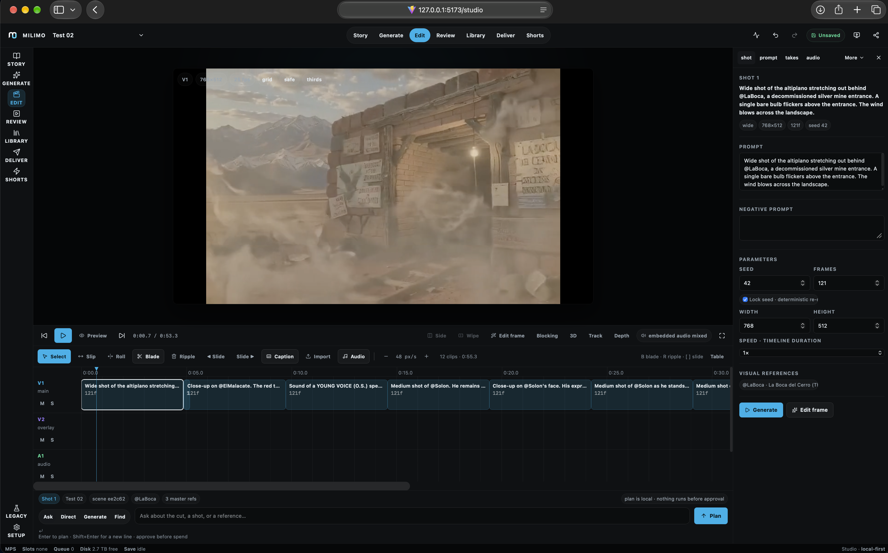

# Milimo Video

<div align="center">


**The AI-Native Cinematic Studio**

[](LICENSE)
[](web-app/)
[](backend/)
[](https://github.com/Lightricks/LTX-2)

</div>

---

**Milimo Video** is an open-source, local-first AI film studio: a storyboard, a
shot-generation workspace, a non-linear editor, a review room, and a delivery desk
in one application. It runs on your machine. No cloud account is required for the
project, the cut, the models, or the render.

There are two interfaces during the strangler cutover:

- **Studio** — `http://localhost:5173/studio`. The current shell: Story, Generate,
  Edit, Review, Library, Deliver, Shorts, and Setup.
- **Legacy editor** — `http://localhost:5173/`. Frozen fallback for the cutover
  window. Set `VITE_STUDIO_ENABLED=false` to serve it at `/studio` as a rollback.

The Tauri desktop shell hosts the same Studio UI with native Open/Save dialogs and
a backend supervisor.

## ✨ What makes it a studio

### One project, three lenses

- **Story** — script parsing, story spine, infinite board, shot list, typed links,
  notes, master-reference cards, review task cards, and board undo.
- **Generate** — ingredients and `@trigger` mentions, advanced parameters, a
  persistent seed lock, start/end-frame conditioning, preview stills, batch queue
  and matrix, immutable takes, favorites, inpaint, and a pipeline lens whose
  reproducible recipe can be exported and imported as JSON.
- **Edit** — program monitor, compare/wipe, guides, magnetic V1 plus free V2/A1,
  trim/slip/roll/blade/ripple/rate/slide, audio gain/mute/fades/solo, waveform,
  captions with SRT/VTT import and burn-in, motion keyframes, render range, a
  timeline table/keyboard path, object tracking, local depth overlay, blocking
  lens, and lazy 3D previz.

### Takes, review, and delivery

- Every completed generation is an immutable take with seed, model, and lineage.
- Review supports frame comments, approvals, activity, compare, a needs-you tray,
  and capability share links.
- Library covers uploads, master references, takes, and ranked local search.
- Any image, video, audio, or caption file opens in a global preview with native
  playback, full-size image display, download, and text/caption rendering.
- Video cards use generated poster frames and play a muted preview on hover.
- Deliver writes the computed cut with V1/V2 compositing, embedded audio + A1 mix,
  trims, speed, fades, keyframes, captions, render range, and persisted encoding
  settings (CRF, encoder speed, audio bitrate, optional loudness normalization).
- Shorts builds scored candidate windows from a transcript or shot text, supports
  editable in/out ranges, and exports 9:16, 1:1, and 4:5 crops from the cut or an
  uploaded source.
- Setup exposes real device/slot/queue/disk state, queued and cancellable model
  downloads, LoRA activation and strength, an optional local Depth Anything V2
  model, queue pause/resume, integrity scan/repair, and a job error budget.

### Visual conditioning & character consistency

- **Story Elements / Master References** — reusable Characters, Locations, Objects,
  and Styles with `@trigger` words. Trigger detection injects reference images and
  enriched prompt context.
- **IP-Adapter** — Flux 2 reference conditioning for identity and style.
- **Reference conditioning** — native AE reference encoding for generation.
- **Projected latents** — reference images can be projected into LTX-2 latent space.

### Storyboard engine and chained generation

- Paste screenplay text; the local parser produces scenes and shots. AI parsing is
  queued through the GPU ledger rather than blocking the request.
- Character/Location/Object matching uses `ElementMatcher` with provenance.
- Shots over the native 121-frame chunk generate autoregressively with a 25-frame
  overlap, pixel `media_sequence` handoff, and start-trimmed audio alignment.

### Inpainting, segmentation, tracking, depth

- **Flux 2 RePaint** inpainting from a text mask, SAM points, or an uploaded mask.
- **SAM 3** text/box/click segmentation and bidirectional video object tracking via
  a separate microservice on port 8001.
- **Depth Anything V2 Small** (optional, downloaded in Setup) produces a local
  monocular depth map for the Edit stage.
- Jobs run through the durable GPU ledger with one OOM retry and a single heavy
  model slot.

### Inside the studio


*Story — scene spine, shot cards, master references, and the Plan dock.*



*Edit — program monitor, V1/V2/A1 timeline, clip tools, and shot parameters.*


### Local-first AI configuration

Every AI text job is a role, not a global toggle. **Setup → AI & LLM** manages
provider *instances* (`ollama`, `openai_compatible@127.0.0.1:8787`, …), so Ollama,
oMLX, Strata, LM Studio, vLLM, and llama.cpp can run at once.

- **Roles** — `prompt_video`, `prompt_image`, `script_parse`, `agent_plan`,
  `review_critic`, and `continuity` route independently with ordered fallbacks.
  Gemma only serves video prompts inside a loaded LTX pipeline; image and script
  roles use a local HTTP model.
- **Capability truth** — the catalog reports context window, parameter size,
  vision, and chat/embedding eligibility. Embedding and tool/audio models cannot
  be assigned to a text role.
- **Discovery and health** — scan loopback ports, attach an engine, verify it,
  warm it, and read load time / tokens-per-second. `Check plan` names any role
  model missing from a live catalog.
- **Eval and presets** — run local shot/image/script fixtures, record pass rate
  and p50 per role, apply the recommended plan, and stage Sovereign local /
  Local preferred / Hybrid profiles.
- **Cloud on top** — cloud calls require `MILIMO_LLM_CLOUD=1`, air-gap off, a
  positive daily budget, and a known per-model rate. Unknown prices fail closed;
  an optional eval gate requires a passing eval before a cloud role is saved.
- **Vision and provenance** — reference images are sent over Ollama/OpenAI/
  Anthropic wires, and each take records the model that enhanced its prompt.

### Memory, scheduling, and progress

- **Measured memory budget** — `services/memory` reads total RAM, the MPS working
  set, physical free, swap free, in-process slots, external LLM engines, and SAM.
  The job estimator includes weights, frames, resolution, upscale, and a safety
  margin. Admission runs before every heavy load; a job that cannot fit is offered
  the largest preset that does, or waits for the running job to release its slot.
- **Residency** — slots carry bytes, leases, last-used, and a pin; idle models are
  evicted on a TTL or under pressure, and a leased slot is never evicted. Ollama
  and oMLX can be unloaded remotely; Strata is budgeted from a declared `memory_gb`.
- **One queue, priority-aware** — interactive video/image work outranks bulk
  elements/thumbnails and background parsing, with same-slot grouping to avoid
  Flux↔LTX thrash. A transient memory refusal becomes a visible
  “waiting for memory” state rather than a failure.
- **Truthful progress** — every job emits typed `job.*` events (`queued`, `started`,
  `stage`, `progress`, `retrying`, `waiting`, `completed`, `failed`, `cancelled`)
  with a sequence id and `Last-Event-ID` replay. Studio shows inline progress,
  toasts, an activity center with history/retry, a macOS dock badge, and optional
  desktop notifications. A single terminal emitter writes the DB once and emits
  once.
- **Recovery** — startup fails interrupted jobs instead of silently re-running
  them; pending cancel clears both the `Job` and the `QueuedJob`; the OOM retry
  drops upscale, steps, and frames, then re-admits before retrying.

## 🛠️ Architecture


| Layer | Technology |
|---|---|
| **Studio frontend** | React 19.2, TypeScript, Vite, Zustand document/editor/job/agent stores, TanStack Query, zod contracts |
| **Legacy frontend** | React + Vite NLE at `/`, separate timeline store, frozen fallback |
| **Backend** | FastAPI (Python 3.12 in the checked-in venv), SQLModel/SQLAlchemy + SQLite, Alembic, SSE via `sse-starlette` |
| **Video AI** | LTX-2 19B — `ti2vid`, `ic_lora`, `keyframe`, chained generation |
| **Image AI** | Flux 2 Klein 9B — IP-Adapter, True CFG, RePaint inpainting |
| **Segmentation** | SAM 3 microservice (port 8001) — text/box/click masks and video tracking |
| **Prompt AI** | Local-first role plane — Gemma 3 in-process, Ollama, oMLX, Strata, LM Studio, vLLM/llama.cpp; optional cloud behind a daily budget, eval gate, and air-gap |
| **Processing** | FFmpeg/ffprobe — render, probes, thumbnails, frame extraction, stitching |
| **Memory & scheduling** | Measured budget/admission, leases + TTL eviction, engine adapters (Ollama/oMLX/Strata), priority queue with same-slot grouping, bounded memory waits |
| **Events** | Typed `job.*` SSE envelope with `seq`/replay, single terminal emitter, Studio toasts/activity center, optional terminal webhook |
| **Desktop** | Tauri 2 — native Open/Save dialogs, backend supervisor, sidecar-binary lookup, window-title + dock-badge progress, macOS Notification Center |

### Backend surface

- Thirteen routers and 139 operations across 122 paths: projects, jobs, assets,
  storyboard, elements, shots, models, planner, review, share, depth, settings,
  system memory.
- Pydantic write boundaries, generated OpenAPI TypeScript, and zod contract checks.
- Alembic baseline `0001_baseline` plus `0002_render_settings`,
  `0003_seed_lock`, `0004_asset_thumbnail`, `0005_app_settings`, and
  `0006_job_progress` (`job.stage`, `started_at`, `memory_json`); legacy DBs are
  repaired and stamped at head.
- LLM plane: persisted settings with provider instances and revision CAS,
  capability-aware discovery, role eval, cloud spend ledger, and staged profiles.
- `QueuedJob` ledger, one global GPU semaphore, priority + same-slot grouping, one
  budget-aware OOM retry, bounded “waiting for memory”, startup recovery,
  idempotent shot jobs, pause/resume dispatch, queue position/estimate.
- Memory API: `/system/memory`, `/system/memory/preflight`,
  `/system/memory/unload`, `/system/memory/keep-warm`; LLM residency at
  `/settings/llm/memory` and per-provider unload.
- `X-Request-ID`, timing logs, `/health` (memory + sampler), `/metrics/jobs`
  (memory counters, queue-wait p50/p95, SSE stats), and an error-budget UI.
- Loopback by default, CORS allowlist, optional bearer token, safe Range media
  serving, upload allowlist/size cap.

### MPS-first notes

- FP8 is CUDA-only; Apple Silicon uses the regular MPS path. On CUDA the budget
  uses free VRAM (`mem_get_info`) and the FP8 19B base (40 GB); the process is
  capped with `set_per_process_memory_fraction` (default 0.90).
- The VAE is cast to float32 on MPS to prevent black output; accelerator caches are
  cleared between jobs.
- Long video jobs are chunked; the GPU semaphore prevents two heavy models loading
  at once.
- SAM 3 auto-selects CUDA → MPS → CPU and guards CUDA-only calls. The image model
  is lazy: the service starts at ~0 GB and loads on the first segmentation
  request (`/load` warms, `/unload` releases); the budget counts it only when
  resident.
- `PYTORCH_ENABLE_MPS_FALLBACK=1` is used for unsupported SAM 3 ops.
- Uvicorn reload is opt-in (`MILIMO_RELOAD=1`); the default run does not walk the
  repository while a generation is running.

## 📚 Documentation

- [User Guide](docs/user_guide.md) — the definitive Studio-first manual.
- [Local API and automation](docs/07_api.md) — REST batch generation, SSE progress,
  preflight, auth, and queue control.
- [Wiki index](Milimo%20Video/index.md) — interlinked systems, models, pipelines,
  workflows, decisions, and roadmap.
- [System Architecture](docs/01_system_architecture.md)
- [Data Models](docs/02_data_models.md)
- [AI Pipelines](docs/03_ai_pipelines.md)
- [Frontend State](docs/04_frontend_state.md)
- [Execution Flow](docs/05_execution_flow.md)
- [File Dependencies](docs/06_file_dependency.md)
- [Flux 2 Bible](docs/flux2-bible.md), [LTX-2 Bible](docs/ltx2-bible.md),
  [SAM 3 Bible](docs/sam3-bible.md)
- [Implementation plan](Milimo%20Video/roadmap/implementation-plan-2026-11.md) —
  scoped v1 status, remaining/deferred items, verification matrix.
- [LLM local-first plan](Milimo%20Video/systems/llm-local-first-next-2026-11.md) —
  live measurements, findings, and the implemented L5–L9 plane.

## 🚀 Getting Started

### Prerequisites

- **Python 3.12** (the repo venv is `milimov/`)
- **Node.js 22+**
- **FFmpeg and ffprobe** on `PATH`
- **Apple Silicon:** 32 GB unified memory or more recommended for LTX-2 19B.
- **NVIDIA:** 16 GB+ VRAM recommended.
- **Disk:** model checkpoints are large; Setup reports free space before download.

### 1. Install

```bash
git clone https://github.com/mainza-ai/milimovideo.git
cd milimovideo
python3 -m venv milimov
./milimov/bin/pip install -e ./LTX-2/packages/ltx-core \
  -e ./LTX-2/packages/ltx-pipelines -e ./flux2 \
  -r backend/requirements.txt
cd web-app && npm install && cd ..
```

### 2. Models

Download LTX-2, Flux 2, and SAM 3 checkpoints as described in the
[User Guide](docs/user_guide.md), or use Setup's model table to inspect/download
supported entries. Depth Anything V2 Small is optional and only needed for the
Edit depth overlay.

SAM 3 is optional for segmentation/tracking; without it the rest of the studio
still runs.

### 3. Launch

```bash
./run_backend.sh     # verifies the environment, then serves http://127.0.0.1:8000
./run_sam.sh         # optional SAM 3 on port 8001
./run_frontend.sh    # Vite on http://127.0.0.1:5173
```

Open **`http://localhost:5173/studio`** for the Studio shell. The legacy editor is
at `/`.

Local LLM engines are discovered automatically. Optional environment:
`MILIMO_LLM_CLOUD=1` enables cloud providers (still gated by air-gap, budget, and
price), `MILIMO_SECRET_KEY` seals stored API keys with AES-256-GCM, and
`MILIMO_LLM_RATE_CARD` points at a JSON price override.

Memory and scheduling environment:

- `MILIMO_MEMORY_ENFORCE=0` disables admission (tests/benchmarks only).
- `MILIMO_MEMORY_RESERVE_GB`, `MILIMO_MPS_MEMORY_FRACTION`,
  `MILIMO_MEMORY_SWAP_LIMIT_PERCENT` tune the budget.
- `MILIMO_MEMORY_TTL_{VIDEO,IMAGE,LLM,SAM,DEPTH}` and `MILIMO_MEMORY_KEEP_WARM`
  tune idle eviction.
- `MILIMO_RELOAD=1` enables Uvicorn reload for development.
- `MILIMO_JOB_WEBHOOK` (+ `MILIMO_JOB_WEBHOOK_TOKEN`) posts terminal jobs to a
  local automation endpoint; off by default.

Desktop:

```bash
cd web-app
npm run tauri dev
npm run tauri build
```

If the backend is offline, the top-bar status offers **Start backend**, which runs
`run_backend.sh` from the checkout. No Python/Torch runtime is bundled yet; the
supervisor will launch a `milimo-backend` sidecar binary if one is shipped.

### Health

```bash
curl http://127.0.0.1:8000/health
```

Reports device, GPU busy/queued, memory slots and measured budget, sampler state,
queue pause state, auth mode, and free disk.

## 🎮 Controls

### Studio

| Key | Action |
|---|---|
| `1`–`8` | Story, Generate, Edit, Review, Library, Deliver, Shorts, Setup |
| `Space` | Play/pause (opens Edit when needed) |
| `⌘K` / `Ctrl+K` | Command palette |
| `⌘J` / `Ctrl+J` | Agent command dock |
| `?` | Keyboard shortcuts |
| `⌘Z` / `Ctrl+Z` | Undo |
| `⇧⌘Z` / `Ctrl+Shift+Z` | Redo |
| `B` | Blade at the playhead |
| `R` | Ripple delete |
| `[` / `]` | Slide selected V1 clip |
| `Escape` | Exit focus mode |

Board: drag empty canvas to pan, `⌘`/`Ctrl`+wheel to zoom, `Shift`-click to
multi-select, `Shift`-drag to marquee. Timeline: drag clip edges to trim; the table
view exposes keyboard editing.

### Legacy

The legacy editor keeps its original shortcuts, including `S`/`⌘S` save and the
masking/tracking toggles. New work belongs in Studio.

## ✅ Verification

```bash
./milimov/bin/python -m compileall -q backend
./milimov/bin/python -m pytest                    # 180 tests
./milimov/bin/python -m ruff check backend        # correctness rules
./milimov/bin/python backend/verify_setup.py      # 0 failures expected

cd web-app
npx tsc -b --pretty false
npm run lint
npm test                                          # 79 tests
npm run build
npm run check:bundle                              # JS budget
npm run test:e2e                                  # 21 Playwright tests
```

The last verified run was 180 backend tests, 79 Vitest tests, and 21 Playwright
tests, including all-surface axe, CRUD, export, reference CRUD, review-agent,
LLM settings (stream/eval/profile), responsive layout/overflow, perf, memory
budget/admission/lease/eviction, typed job events/replay/terminal-once, and visual
checks.

## 🧭 Project layout

```
backend/           FastAPI, tasks, routes, models, Alembic, tests
web-app/           React/Vite Studio + legacy editor + Tauri shell
  src/studio/      Studio shell, stores, surfaces, lenses, shorts, collab
  src-tauri/      Native shell and backend supervisor
sam3/              Optional SAM 3 microservice
tests/             Backend pytest suite
docs/              Immutable technical sources and user guide
Milimo Video/      LLM-owned wiki (systems, models, pipelines, roadmap)
dev_diary/         Build log and social notes
```

## ⚠️ Known limitations

- **No bundled Python runtime.** The desktop shell can start a sidecar binary if
  present, but packaging Python/Torch is not built.
- **Legacy `/` remains** until the documented two-clean-release cutover window.
- **Scoped v1 cut:** no transitions, LUTs, titles, or A2 track; search is ranked
  lexical matching, not embeddings; Shorts/lenses have no template packs.
- **Depth model** is downloaded separately and is not shipped in the repo.
- **Memory**: the cost registry is a measured estimate, not a per-model profile;
  Strata has no unload endpoint; a cancelled job keeps its pipeline until the idle
  TTL; only the MPS decode path is tiled; memory waits are bounded at 20 retries.
- **16 GB CUDA**: LTX-2 FP8 is estimated at 40 GB. The job is refused before load;
  CPU offload is not implemented and no quantized Flux 2 checkpoint is shipped yet.
  See the [issue triage](Milimo%20Video/systems/github-issues-triage-2026-11.md).
- **Model efficiency (M5)**: SAM is lazy and `backend/benchmark_models.py` records
  per-lane baselines, but quantized/distilled checkpoints and text-encoder
  alternatives need model artifacts that are not vendored.
- **Desktop**: macOS notifications use `osascript`; dock/window progress is wired,
  but a tray icon is not.
- **Visual baselines** are platform-tolerant and locally generated.
- **LLM caveats:** cancelling a non-stream HTTP call is timeout-bounded rather
  than a socket abort; chained chunk-0 enhancement still follows the pipeline
  load; Strata reports no context window; cloud list prices are reference data
  (`MILIMO_LLM_RATE_CARD` overrides); vision detection is heuristic; the legacy
  `/` popover edits only `prompt_video`.
- **Phase 6 v2 work** (model-artifact eval, model swaps, MLX/FP8 lanes, agent
  crew) is a separate program, not part of scoped v1.

## 🤝 Community

Milimo Video is open source. Contributions are welcome:

- **Code** — pull requests for features, fixes, and performance.
- **Models** — share LoRAs or fine-tunes that work with LTX-2/Flux.
- **Feedback** — open issues on the [GitHub repository](https://github.com/mainza-ai/milimovideo).

## ✍️ Author

**Mainza Kangombe**  
[](https://www.linkedin.com/in/mainza-kangombe-6214295)

## 📜 License

Apache 2.0. See [LICENSE](LICENSE) and [NOTICE](NOTICE).
