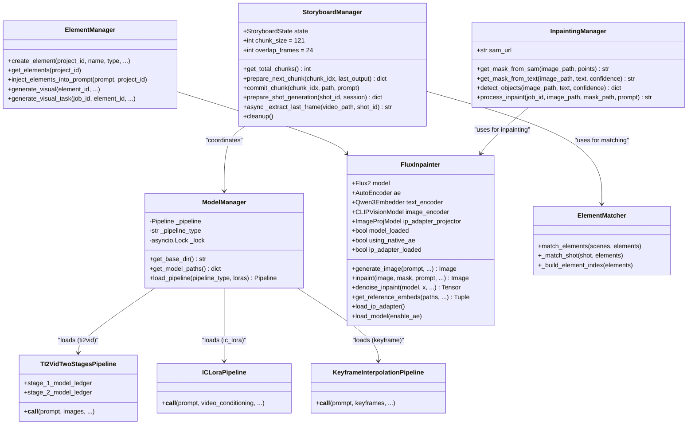
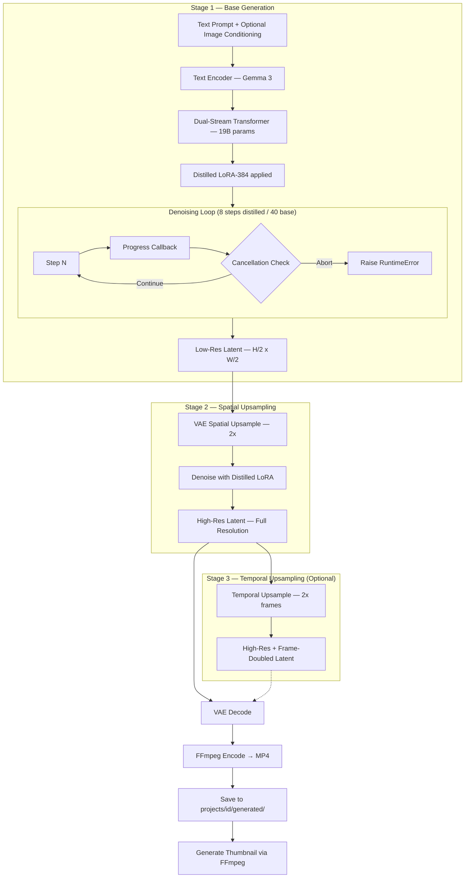
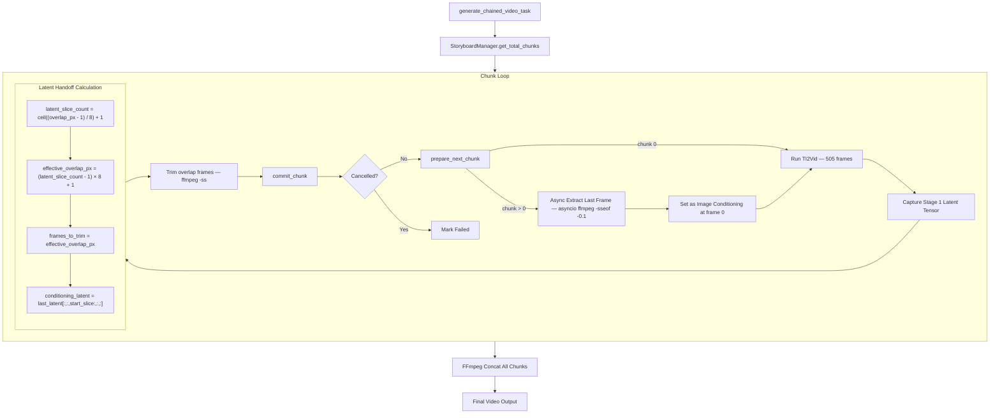
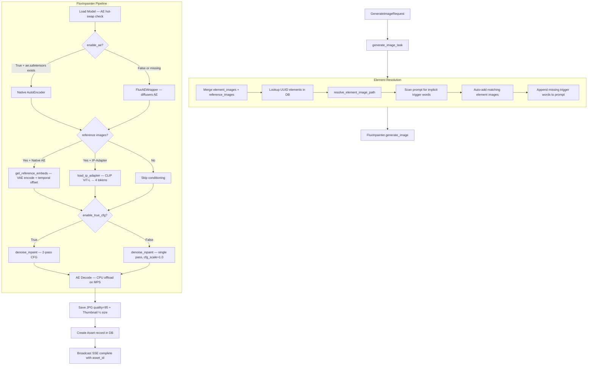
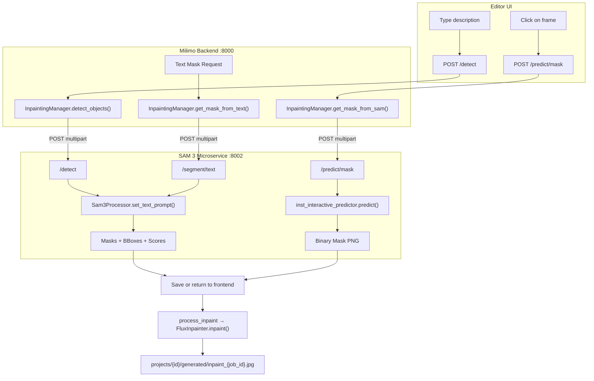
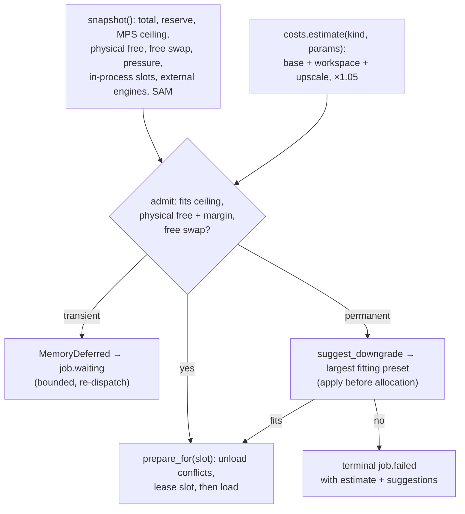
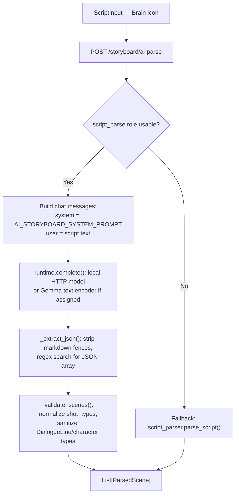
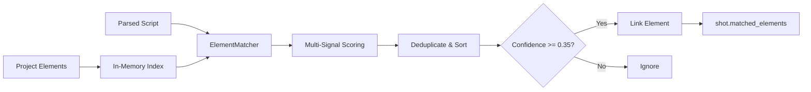

# Milimo Video — AI Pipeline Analysis

## 1. Pipeline Architecture Overview



## 2. LTX-2 Video Generation

### 2.1 Pipeline Selection Logic

The `generate_video_task()` function in `tasks/video.py` determines which pipeline to load:

| Condition | Pipeline | Use Case |
|---|---|---|
| `num_frames == 1` | **Flux 2** (bypass LTX) | Single frame → delegates to `FluxInpainter.generate_image()` |
| `pipeline_override == "auto"` + 2 images at different frames | `keyframe` | Keyframe interpolation between start/end frames |
| `pipeline_override == "auto"` + IC-LoRA elements | `ic_lora` | Subject consistency via IC-LoRA concept injection |
| `pipeline_override == "auto"` (default) | `ti2vid` | Text/Image-to-Video (primary pipeline) |
| `ti2vid` AND `num_frames > 505` | chained task | Autoregressive continuation → `generate_chained_video_task()` |

### 2.2 Two-Stage Generation Process (`TI2VidTwoStagesPipeline`)



### 2.3 Image Conditioning Mechanism

Milimo uses `image_conditionings_by_replacing_latent` with a strict priority system to determine the starting frame (Frame 0):

1. **Manual Timeline Image**: Explicitly set by user (Highest Priority).
2. **Concept Art (Thumbnail)**: If present, used as the starting frame. This enables "Image to Video" behavior where the video evolves from the concept art.
3. **Continuity (Previous Shot)**: If no Concept Art exists, the last frame of the previous shot is used (flow continuity).

**Process:**
1. Input images are encoded to latents via the video VAE.
2. These latents **replace** noisy latents at specific spatiotemporal positions (usually frame 0).
3. Acts as a "hard" constraint for the diffusion start point.
4. Supports multiple conditioning items, though typically only one is used for Frame 0 based on the priority above.

### 2.4 Chained Generation — Quantum Alignment

For videos exceeding 505 frames, `tasks/chained.py` implements autoregressive chunk-by-chunk generation:



**Chunk Parameters:**
- `chunk_size`: 505 frames (LTX-2 native limit)
- `overlap_frames`: 24 frames (requested pixel overlap)
- `effective_step`: 481 frames per chunk (505 - 24)

**Quantum Alignment Math** (latent grid = 8 pixels/latent):
| Parameter | Formula | Example (24 px overlap) |
|---|---|---|
| `latent_slice_count` | `ceil((24-1)/8) + 1` | = 4 latents |
| `effective_overlap_px` | `(4-1) × 8 + 1` | = 25 pixels |
| `frames_to_trim` | = `effective_overlap_px` | = 25 frames |

**Why "Quantum"**: The latent grid quantizes continuous pixel space into 8-pixel steps. Overlap must be aligned to this grid to avoid discontinuities. Misaligned overlaps cause "frozen anchor" artifacts where the overlap region appears static.

### 2.5 MPS Compatibility (LTX-2)

| Issue | Fix | Location |
|---|---|---|
| FP8 unsupported on MPS | `fp8transformer=False` on MPS | `model_engine.py` line 103 |
| VAE decode → black frames | `pipeline.vae.to(dtype=torch.float32)` | `model_engine.py` line 144 |
| `bfloat16` → dtype mismatch | Pipeline loader casts all weights to float32/float16 | LTX pipeline constructors |
| Memory fragmentation | `gc.collect()` + `torch.mps.empty_cache()` on pipeline swap | `model_engine.py` line 80 |

## 3. Flux 2 Image Generation

### 3.1 FluxInpainter Architecture



### 3.2 Sequential "True" CFG

Flux 2 natively uses **Guided Distillation** (single scalar guidance vector) and ignores negative prompts. Milimo re-enables standard negative prompting via a custom double-pass loop in `denoise_inpaint()`:

1. **Pass 1 (Unconditional)**: Model forward with empty/negative text embeddings. IP-Adapter tokens **stripped**.
2. **Pass 2 (Conditional)**: Model forward with positive text + IP-Adapter tokens.
3. **CFG Blend**: `pred = pred_uncond + cfg_scale × (pred_cond - pred_uncond)`

| `enable_true_cfg` | `cfg_scale` | Negative Prompt | Performance Impact |
|---|---|---|---|
| `False` (default) | `1.0` (disabled) | **Ignored** | No overhead |
| `True` | `2.0` (fixed safe) | Active | 2× inference time |

### 3.3 Reference Image Conditioning (Native AE)

`get_reference_embeds()` encodes reference images into the Flux 2 temporal embedding space:

1. Load PIL images from paths (max 3 refs on MPS, capped at 768² pixels).
2. Center-crop to multiple of 16, normalize to `[-1, 1]`.
3. Encode through `ae.encode()` → latent tokens.
4. Assign temporal offsets: `t_off = scale + scale × t` (scale=10) to separate refs from target.
5. During denoising: `model_input = cat(x, img_cond_seq)` — ref tokens concatenated.

### 3.4 IP-Adapter Integration

| Component | Details |
|---|---|
| **Vision Encoder** | `openai/clip-vit-large-patch14` (CLIPVisionModelWithProjection) |
| **Projector** | `ImageProjModel`: `Linear(1024, 4×4096)` → reshape → `LayerNorm(4096)` |
| **Output** | 4 Flux-hidden-state tokens per reference image |
| **Weights** | `config.FLUX_IP_ADAPTER_PATH` (safetensors) |
| **Injection** | Tokens concatenated to input sequence during denoise loop |

### 3.5 In-Painting (RePaint Method)

Used by `InpaintingManager.process_inpaint()`:

1. Resize image/mask to multiple of 16.
2. Encode image → latents (`x_orig`) via `ae.encode()`.
3. Flatten mask → downscale to latent-size `(H/16, W/16)` → reshape to `(1, L, 1)`.
4. Initialize `x` with pure noise.
5. Each denoising step:
   - Predict update direction.
   - **RePaint blend**: `x_pred = mask × x_pred + (1 - mask) × x_known`
   - Where `x_known = t_prev × noise + (1 - t_prev) × x_orig`
6. Decode result via `ae.decode()` (CPU offload on MPS).
7. Result saved to `projects/{id}/generated/inpaint_{job_id}.jpg`.

### 3.6 MPS Compatibility (Flux 2)

| Issue | Fix | Location |
|---|---|---|
| VAE decode → black images | CPU + float32 for decode only | `FluxAEWrapper.decode()` |
| Transformer NaNs with bf16 | Force `float32` for entire flow model | `FluxInpainter.__init__` |
| Memory fragmentation | `gc.collect()` + `torch.mps.empty_cache()` before denoise | `generate_image()` |
| Reference image OOM | Cap to 3 refs, max 768² pixels on MPS | `get_reference_embeds()` |

## 4. SAM 3 Segmentation & Tracking



### SAM 3 Microservice API

| Endpoint | Method | Request | Response |
|---|---|---|---|
| `/health` | GET | — | `{"status": "running", "model_loaded": bool, "processor_ready": bool}` |
| `/predict/mask` | POST | `image` (file) + `points` (JSON) + `labels` (JSON) + `multimask` (bool) + `boxes` (JSON, optional) | Binary PNG mask, or JSON multi-mask with scores |
| `/detect` | POST | `image` (file) + `text` (str) + `confidence` (float) | JSON: `{objects: [{mask, bbox, score, label}]}` |
| `/segment/text` | POST | `image` (file) + `text` (str) + `confidence` (float) | Binary PNG mask (all objects merged) |
| `/track/start` | POST | `video_path` (str) | `{session_id, status}` |
| `/track/prompt` | POST | `session_id` + `frame_idx` + `text`/`points`/`boxes` | `{status: "prompt_added"}` |
| `/track/propagate` | POST | `session_id` + `direction` + `start_frame` + `max_frames` | `{frames: [{frame_idx, masks}]}` |
| `/track/stop` | POST | `session_id` | `{status: "closed"}` |

**Server Configuration:**
- Port: `config.SAM_SERVICE_PORT` (default 8002)
- Model: `backend/models/sam3/sam3.pt` (~3.4GB, auto-downloads from HuggingFace if missing)
- Device: auto-detected (`cuda` > `mps` > `cpu`)
- MPS Fallback: `PYTORCH_ENABLE_MPS_FALLBACK=1` (set in `run_sam.sh`) for ops not yet on MPS
- Startup: `build_sam3_image_model(checkpoint_path, device, enable_inst_interactivity=True)` + `Sam3Processor`
- Video predictor: lazy-loaded on first `/track/*` request; `device` is passed to `Sam3VideoPredictor(device=...)` for CUDA/MPS/CPU placement
- Inpaint job persistence: `POST /edit/inpaint` creates a `Job` DB record; `update_job_db()` called on completion/failure

### 4.1 MPS Compatibility (SAM 3)

| Issue | Fix | Location |
|---|---|---|
| `grid_sample` crashes with empty tensors | Early return guard when `n_points == 0` | `geometry_encoders.py:_encode_points` |
| `pin_memory()` is CUDA-only | Replaced with direct `.to(device=...)` | `geometry_encoders.py:_encode_boxes` |
| `_assert_async` not implemented on MPS | `PYTORCH_ENABLE_MPS_FALLBACK=1` env var | `run_sam.sh` |
| FLASH/EFFICIENT SDPA backends unavailable | Restrict to `MATH` backend on MPS | `vl_combiner.py:forward_text` |
| BFloat16 incompatible with numpy | `.float()` cast before `.numpy()` | `start_sam_server.py:detect_objects` |
| `Sam3VideoPredictor.__init__()` hardcodes `.cuda()` | Added `device` param; `.to(self.device)` with auto-detect (CUDA → MPS → CPU) | `sam3_video_predictor.py:__init__` |
| `_get_session_stats()` / `_get_torch_and_gpu_properties()` call `torch.cuda.*` | Guarded behind `torch.cuda.is_available()` | `sam3_video_predictor.py` |

## 5. Model Management & Memory

### Central Memory Manager (`memory_manager.py`)

On Apple Silicon with unified memory, GPU models share the same physical RAM.
Slots still enforce mutual exclusion, but they are now backed by a **measured
budget** (`backend/services/memory/`):



**Budget inputs:** total RAM, a 15% reserve, `torch.mps.recommended_max_memory()`,
`psutil.virtual_memory().available`, free swap, `kern.memorystatus_vm_pressure_level`,
resident slots, external engines, and SAM. Swap **occupancy** is reported but is not
itself a refusal: macOS keeps swap allocated after a heavy job, so admission uses
free swap + physical free + pressure.

**Admission runs before every heavy load** — video, image, chained, ai_parse,
inpaint, element, pipeline activation, LLM warm/reserve. The decision carries
`retryable`, the reclaimable set, suggestions, and a `downgrade` preset. A
transient refusal raises `MemoryDeferred` and becomes a visible wait; a permanent
one applies the fitting preset (upscale off → fewer frames → smaller resolution)
and persists it to the Job/QueuedJob/Shot before any allocation.

**Slot lifecycle:**
- `model_engine.py` calls `prepare_for("video")` before loading any LTX pipeline →
  unloads Flux and any warm `llm_http` engine; a failed load releases the slot.
- `flux_wrapper.py` calls `prepare_for("image")` before loading Flux → unloads LTX
  and `llm_http`; failures release the image slot.
- Slots carry `leases`; a leased slot is never evicted. Activation/deactivation is
  refused while a job is active.
- Idle TTL (`MILIMO_MEMORY_TTL_*`) and pressure evict unleased slots; `keep-warm`
  pins one. `/system/memory/unload` and `/keep-warm` are the manual controls.
- Engine adapters measure Ollama (`/api/ps`), oMLX (`/v1/models/status`), and use a
  declared `memory_gb` for Strata/generic engines. SAM is lazy and released via
  `/unload`.
- The sampler records a 1 s peak trace per stage into `Job.memory_json`.

**Scheduling:** the durable `QueuedJob` ledger feeds one GPU semaphore. Dispatch is
ordered by priority (video/image 20, inpaint 30, element 50, ai_parse/depth 60),
then by the slot already resident, then FIFO. A “waiting for memory” row sleeps on
its own timer and is re-dispatched without holding the semaphore. The OOM retry
drops upscale, steps, and frames, re-admits, and emits `job.retrying`.

### Local LLM residency and keep-alive

Each provider instance carries its own `keep_alive` (default `"0"` for Ollama)
and timeout. `MILIMO_OLLAMA_KEEP_ALIVE` seeds the first-boot value, then Studio
→ AI & LLM is authoritative.

- `keep_alive: 0` unloads the model after the call; `5m` keeps it warm (a 3B on
  the reference machine went from 7.4 s cold to 2.2 s warm).
- After enhancement, `runtime.release_local()` unloads **every model a role could
  have used** and the provider default, and releases the `llm_http` slot. It waits
  for the engine's response and reports engines that own their residency.
- oMLX, Strata, LM Studio, and llama.cpp own their load/unload; Milimo does not
  pretend it freed them. `prepare_for("video"/"image")` drops the slot before a
  heavy model loads.
- A cold 27B oMLX load took 36 s on the reference machine; the panel's **Warm**
  action separates that from inference and records `last_load_ms`.

### Device Selection
```python
device = "cpu"
if torch.cuda.is_available():
    device = "cuda"
elif torch.backends.mps.is_available():
    device = "mps"
```

### Pipeline Swap Logic (ModelManager)
When switching pipeline types:
1. Delete existing pipeline reference
2. Call `gc.collect()`
3. Empty GPU cache (`torch.cuda.empty_cache()` / `torch.mps.empty_cache()`)
4. **Call `memory_manager.prepare_for("video")`** — unloads Flux if loaded
5. Load new pipeline with appropriate checkpoint
6. If MPS: force `pipeline.vae` to `float32`

### AE Hot-Swap Logic (FluxInpainter)
When `enable_ae` toggle changes between calls:
1. Full model unload (flow model, AE, text encoder, IP-Adapter)
2. `memory_manager.release("image")` called
3. Reload with new AE variant (native or diffusers)
4. Tracked via `last_ae_enable_request` memo

### Checkpoint Auto-Selection (ModelManager)
1. Priority: `ltx-2-19b-distilled.safetensors` (full precision)
2. Fallback: `ltx-2-19b-distilled-fp8.safetensors` (FP8, CUDA only)
3. Warning logged if neither found

### Model Paths (from `config.py`)
| Model | Path |
|---|---|
| LTX-2 Checkpoint | `LTX-2/models/checkpoints/ltx-2-19b-distilled.safetensors` |
| LTX-2 FP8 (fallback) | `LTX-2/models/checkpoints/ltx-2-19b-distilled-fp8.safetensors` |
| Distilled LoRA-384 | `LTX-2/models/checkpoints/ltx-2-19b-distilled-lora-384.safetensors` |
| Spatial Upsampler | `LTX-2/models/upscalers/ltx-2-spatial-upscaler-x2-1.0.safetensors` |
| Temporal Upsampler | `LTX-2/models/upscalers/ltx-2-temporal-upscaler-x2-1.0.safetensors` |
| Gemma 3 Text Encoder | `LTX-2/models/text_encoders/gemma3/` |
| Flux 2 Klein 9B | `backend/models/flux2/flux-2-klein-9b.safetensors` |
| Flux Native AE | `backend/models/flux2/ae.safetensors` |
| Flux Diffusers AE | `backend/models/flux2/vae/` |
| Flux Text Encoder | `backend/models/flux2/text_encoder/` (Qwen 3 8B) |
| Flux IP-Adapter | `backend/models/flux2/ip-adapter.safetensors` |
| SAM 3 Checkpoint | `backend/models/sam3/sam3.pt` |

## 6. LLM Configuration & Prompt Enhancement

### 6.1 Role runtime (`services/llm/`)

Prompt rewriting is a **role** in a persisted configuration plane, not a
two-provider switch. `llm.py` keeps its public
`enhance_prompt(prompt, system_prompt, is_video, text_encoder)` signature as a
compatibility facade and maps `is_video` to `prompt_video` / `prompt_image`;
`services/llm/runtime.py` resolves the role to an ordered plan of provider
**instances** and executes it.

| Provider type | Wire | Local | Notes |
|---|---|---|---|
| Gemma | `gemma_native` | yes | in-process LTX text encoder; `prompt_video` only |
| Ollama | `ollama_native` | yes | `/api/tags`, `/api/show`, `/api/generate`; `keep_alive` |
| oMLX / Strata / LM Studio / vLLM / llama.cpp | `openai_chat` | yes | `/v1/models`, `/chat/completions`; images and SSE where supported |
| OpenAI | `openai_chat` | no | opt-in; budget + air-gap required |
| Anthropic | `anthropic_messages` | no | opt-in; budget + air-gap required |

Instances use stable ids (`ollama`, `openai_compatible@127.0.0.1:8787`), so several
OpenAI-compatible engines can serve different roles at once. Each hop carries its
own base URL, timeout, keep-alive, model, and per-role sampling.

The runtime adds:

- **Context preflight** — estimated tokens vs the catalog's context window; fail
  fast with the limit instead of a provider 400.
- **Capability gating** — embedding/tool/audio entries cannot serve a text role.
- **Budget checks** — local calls are free; cloud calls need a positive daily budget
  and a known price, otherwise they refuse before egress.
- **Cancellation** at hop boundaries, plus **telemetry** (last load, latency,
  tokens/s) and prompt provenance in `Job.params_json.llm`.
- **Streaming negotiation** — SSE where supported, with a first-byte timeout and a
  non-stream fallback (oMLX has both streamed and stalled).

```python
# Compatibility API used by every worker:
from llm import enhance_prompt, prepare_text_encoder
text_encoder = prepare_text_encoder(pipeline, is_video=True)  # None for HTTP roles
enhanced, is_reference_only = enhance_prompt(
    prompt, system_prompt="...", is_video=True, text_encoder=text_encoder,
)
```

### 6.2 Roles

| Role | Default | Why |
|---|---|---|
| `prompt_video` | Gemma | already loaded with LTX; cinematic prompt schema |
| `prompt_image` | local HTTP | Flux has no LTX text encoder |
| `script_parse` | local HTTP | text-only; avoids loading the video pipeline |
| `agent_plan` | local HTTP | command-dock planning |
| `review_critic` | local HTTP | future take/frame critique |
| `continuity` | local HTTP | future cross-shot checks |

Roles can be explicitly **unassigned**. Each supports ordered fallbacks, and a
role change persists across restarts.

### 6.3 Configuration, discovery, and eval

- **Storage** — `app_setting.key = "llm"`, schema v3 (adds declared `memory_gb`),
  revision CAS, redacted keys.
- **Discovery** — loopback scan identified by catalog shape; 401/403 reports
  `needs_key`; attach is idempotent by normalised base URL.
- **Capability catalog** — context (`/api/show`, `max_model_len`, `meta`),
  parameter size, quantization, vision, chat/embedding flags.
- **Verify / Warm** — live catalog check and measured model load.
- **Eval** — shot/image/script fixtures through the saved plan, pass rate and p50
  per role, persisted as `last_eval`; **Apply recommended** reassigns the tested
  models. With the eval gate on, a cloud role needs a passing eval.
- **Profiles** — Sovereign local, Local preferred, Hybrid.
- **API** — `GET/PUT/PATCH /settings/llm`, `/models`, `/discover`, `/attach`,
  `/providers/{id}/{verify,warm}`, `/test` and `/test/stream`, `/health`, `/eval`,
  `/eval/apply`, `/profiles/{name}`, `/spend`.

### 6.4 VLM structured JSON extraction

- If an input image is provided (`has_input_image=True`), the system prompt instructs
  the VLM to analyze it.
- The VLM outputs a **JSON object** with `enhanced_prompt` and `is_reference_only`.
  The parser also accepts `prompt`, `text`, `image_prompt`, `result`, and `output`,
  strips fences, and falls back to the original prompt if a bare object cannot be
  unwrapped. (Some local models answer `{"prompt": …}`; that no longer reaches Flux.)
- If the image is a Character Sheet or Turnaround (`is_reference_only=True`),
  `tasks/video.py` **drops the image conditioning** to force text-to-video,
  preventing a frozen 2D reference from breaking generation.

### 6.5 Image input

When a caller has a reference image, it is sent on the provider's native wire:

| Wire | Payload |
|---|---|
| Ollama | `images: [base64]` |
| OpenAI-compatible | `messages[].content = [{type: text}, {type: image_url}]` |
| Anthropic | base64 image content block |
| Gemma | LTX `enhance_i2v()` with a resized tensor |

### 6.6 System prompts and callers

**System prompts:** `get_video_system_prompt(duration_seconds, has_input_image)`
(concise action plus an audio layer and JSON output) and `IMAGE_SYSTEM_PROMPT`
(vivid, single-paragraph image prompts).

**Callers:**
- `tasks/video.py` — ti2vid, ic_lora, keyframe, single-frame Flux paths
- `tasks/chained.py` — chunk 0 and narrative continuation for chunks 1+
- `tasks/image.py` — standalone image generation
- `storyboard/manager.py` — chunk continuation prompts
- `services/ai_storyboard.py` — `script_parse`

### Element Injection

- `ElementManager.inject_elements_into_prompt()` scans for trigger words (e.g., `@Hero`) and returns the enriched prompt + list of element image paths for IP-Adapter conditioning
- **Implicit trigger detection**: In `tasks/image.py`, all project elements are scanned — if a trigger word appears in the prompt, the element's reference image is automatically added to `resolved_ip_paths`

## 7. AI Storyboard Analysis

### 7.1 Overview

**File**: `services/ai_storyboard.py`
**Role**: `script_parse` (local HTTP model by default; Gemma only when assigned)
**Endpoint**: `POST /projects/{id}/storyboard/ai-parse` and the queued job variant

Runs free-form text through the `script_parse` role to produce structured scenes
and shots. A local HTTP model (Ollama/oMLX/Strata/LM Studio) needs **no pipeline
load**; the LTX Gemma text encoder is fetched only when the role resolves to
Gemma. This provides a smarter alternative to the regex-based `ScriptParser` for
non-standard scripts, treatments, and prose.

### 7.2 Pipeline



### 7.3 System Prompt

The AI is instructed to act as a **professional storyboard artist and screenwriter**. Key directives:
- Output **valid JSON only** — no markdown explanation
- Each scene: 1–8 shots with varied shot types for cinematic interest
- Action descriptions: vivid and visual, suitable for AI video generation
- Dialogue paired with `close_up` or `medium` shots
- Character names in TITLE CASE
- Valid shot types: `close_up`, `medium`, `wide`, `establishing`, `insert`, `tracking`

### 7.4 JSON Extraction & Validation

`_extract_json()` handles Gemma output quirks:
1. Strip markdown `\`\`\`json` fences
2. Try direct `json.loads()` parse
3. Fallback: regex search for `[...]` array in response
4. Raise `ValueError` if no valid JSON found

`_validate_scenes()` sanitizes the output:
- Unknown shot types default to `"medium"`
- Missing actions get placeholder: `"A cinematic shot."`
- Dialogue/character fields coerced to `str | None`

### 7.5 Concept Art Thumbnails

**Endpoint**: `POST /projects/{id}/storyboard/thumbnails`
**Schema**: `BatchThumbnailRequest` (`shot_ids`, `width=512`, `height=320`, `force=False`)

For each shot without an existing `thumbnail_url` (or when `force=True`):
1. Creates a `Job` DB record with `is_thumbnail=True`
2. Dispatches `generate_image_task()` via `BackgroundTasks`
3. Flux 2 generates concept art at 512×320
4. `tasks/image.py` writes result to `Shot.thumbnail_url` for `is_thumbnail` jobs
5. SSE `complete` event includes `shot_id` — `ServerSlice` matches by `shot_id` (not `lastJobId`) and updates only the thumbnail

## 8. Smart Element Matching

### 8.1 Overview

**File**: `services/element_matcher.py`
**Endpoint**: `POST /projects/{id}/storyboard/match-elements`

The `ElementMatcher` service is a deterministic, multi-signal engine that links storyboard shots to project elements (characters, locations, objects) without requiring LLM inference. It runs after script parsing (AI or Regex) and before commit.

### 8.2 Matching Signals

The engine evaluates 8 distinct signals for every element-shot pair, calculating a composite confidence score.

| Signal | Confidence | Description |
|---|---|---|
| `character_field_exact` | **1.0** | Shot's `character` field exactly matches element name. |
| `trigger_word_in_action` | **0.95** | Element's `@TriggerWord` found in shot action. |
| `name_in_action` | **0.85** | Element name found in shot action text. |
| `partial_name_in_character` | **0.8** | Partial match in `character` field (e.g. "DETECTIVE" matches "Detective"). |
| `name_in_scene` | **0.6** | Element name found in scene heading (e.g. "INT. NEON CITY"). |
| `description_tokens` | **0.5** | Significant overlap between element description tokens and shot action. |
| `dialogue_mention` | **0.5** | Element name spoken in dialogue. |
| `action_keywords` | **0.4** | General keyword match (weak signal). |

### 8.3 Matching Flow



### 8.4 Integration Points

1.  **AI Parser**: `ai_storyboard.py` calls `match_elements()` immediately after Gemma generates the JSON structure.
2.  **Regex Parser**: `script_parser.py` calls `match_elements()` after regex extraction.
3.  **Manual Re-Match**: User can trigger matching on existing shots via the UI (calls `/match-elements`).
4.  **Generation**: `StoryboardManager` uses these matches to:
    *   Inject reference images (IP-Adapter) for characters/locations.
    *   Append trigger words to prompts automatically.

