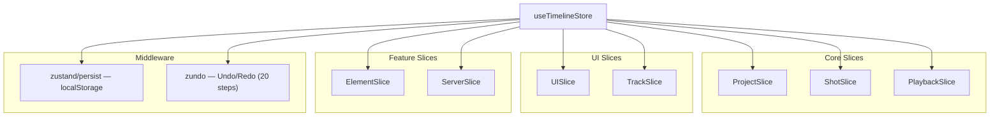
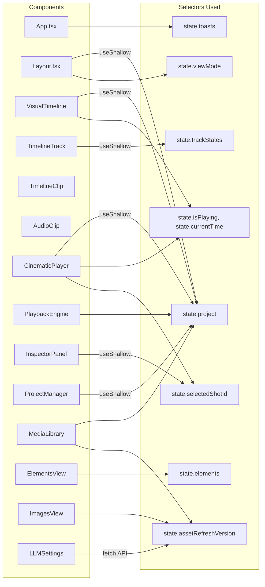
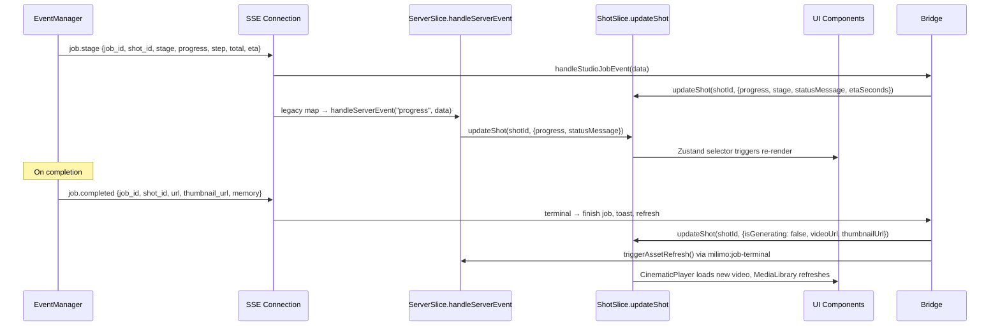

# Milimo Video — Frontend State (Zustand)

## 1. Store Architecture

The `useTimelineStore` is composed from **7 slices**, wrapped with `persist` (localStorage) and `temporal` (undo/redo via `zundo`).



## 2. Slice Responsibilities

### ProjectSlice
| State | Actions |
|---|---|
| `project: Project` | `setProject(p)` |
| `assetRefreshVersion: number` | `triggerAssetRefresh()` |
| — | `saveProject()` (PUT mapped to an UPSERT pattern) |
| — | `createNewProject(name, settings?)` |
| — | `loadProject(id)` |
| — | `deleteProject(id)` |

### ShotSlice
| Actions | Description |
|---|---|
| `addShot(config?)` | Add new shot with defaults |
| `updateShot(id, updates)` | Local state update |
| `patchShot(id, updates)` | Persist to backend via PATCH |
| `splitShot(id, splitFrame)` | Split at frame position |
| `reorderShots(from, to)` | Reorder in V1 track |
| `deleteShot(id)` | Remove shot |
| `moveShotToValues(id, trackIndex, startFrame)` | Move shot to track/position |
| `addConditioningToShot(shotId, item)` | Add conditioning item (image/video) |
| `updateConditioning(shotId, itemId, updates)` | Update conditioning |
| `removeConditioning(shotId, itemId)` | Remove conditioning |
| `getShotStartTime(shotId)` | Compute absolute start time |
| `generateShot(shotId)` | Dispatch generation request → POST `/shots/{shotId}/generate` |
| `inpaintShot(shotId, frame, mask, prompt)` | Dispatch inpainting → POST `/edit/inpaint` |

### PlaybackSlice
| State | Actions |
|---|---|
| `currentTime: number` | `setCurrentTime(t)` |
| `isPlaying: boolean` | `setIsPlaying(p)` |

### UISlice
| State | Actions |
|---|---|
| `selectedShotId: string \| null` | `selectShot(id)` |
| `toasts: Toast[]` | `addToast(msg, type)`, `removeToast(id)` |
| `transientDuration: number \| null` | `setTransientDuration(d)` |
| `viewMode: ViewMode` | `setViewMode(mode)` |
| `isEditing: boolean` | `setEditing(e)` |

**ViewMode**: `'timeline' | 'elements' | 'storyboard' | 'images'`

### TrackSlice
| State | Actions |
|---|---|
| `trackStates: Record<number, TrackState>` | `toggleTrackMute(idx)` |
| — | `toggleTrackLock(idx)` |
| — | `toggleTrackHidden(idx)` |

**TrackState**: `{ muted: boolean; locked: boolean; hidden: boolean }`  
**Track mapping**: `0=V1 (Main)`, `1=V2 (Overlay)`, `2=A1 (Audio)`

### ElementSlice
| `elements: StoryElement[]` | `fetchElements(projectId)` |
| `generatingElementIds: Record<string, string>` | `createElement(projectId, data)` |
| `parsedScenes: ParsedScene[] \| null` | `deleteElement(elementId)` |
| — | `generateVisual(elementId, ...)` → POST `/elements/{id}/visualize` |
| — | `cancelElementGeneration(elementId)` |
| — | `parseScript(text)` → `ParsedScene[]` (regex) |
| — | `aiParseScript(text)` → `ParsedScene[]` (Gemma 3 AI) |
| — | `commitStoryboard(scenes)` |
| — | `generateThumbnails(shotIds)` → Flux 2 concept art |
| — | `updateSceneName(sceneId, name)` → PATCH |
| — | `pushStoryboardToTimeline()` → commit + reload project |

### ServerSlice
| Actions | Description |
|---|---|
| `handleServerEvent(type, data)` | Processes SSE events and updates relevant shot state |

**SSE Event Types Handled (legacy mapping):**
| Event Type | Action |
|---|---|
| `progress` | Update shot `progress`, `statusMessage`, `etaSeconds`, `enhancedPromptResult` |
| `complete` | Set shot `isGenerating=false`, `videoUrl`, `thumbnailUrl`, `progress=100`; trigger `assetRefresh`. Handles both video/image generation and inpainting completions (inpaint events include `type: "inpaint"` and `asset_id`). For `is_thumbnail` jobs: matches by `shot_id` (not `lastJobId`), sets only `thumbnailUrl` without clearing generation state. |
| `error` | Set shot `isGenerating=false`, show toast |
| `cancelled` | Server fully aborted the background job. Set shot `isGenerating=false`, `status="pending"`, and clear active `job_id` lock. |

## 3. Component → Store Mapping



## 4. Middleware Configuration

### Persistence (`zustand/persist`)
```typescript
{
    name: 'milimo-timeline-storage',
    partialize: (state) => ({ project: state.project }),
    merge: (persisted, current) => ({
        ...current,
        ...persisted,
        // Reset transient states on load
        toasts: [],
        isPlaying: false,
        isEditing: false,
        transientDuration: null,
        generatingElementIds: {},
    }),
}
```
Only `project` is persisted to localStorage. All transient state is reset on hydration.

The Studio store (`milimo-studio-document`) is separate and stricter:

```typescript
{
    name: 'milimo-studio-document',
    storage: createJSONStorage(() => createThrottledStorage(400)),
    partialize: (state) => ({
        project: sanitizeProjectForStorage(state.project), // no runtime fields
        savedBaseline: state.savedBaseline,
        saveStatus: state.saveStatus,
    }),
}
```

`sanitizeProjectForStorage` strips `isGenerating`, `progress`, `statusMessage`,
`currentPrompt`, `etaSeconds`, `enhancedPromptResult`, and `lastJobId` from every
shot before writing. Writes are coalesced over 400 ms and flushed on `pagehide` or
when the tab is hidden, so a progress update never serializes the full document
multiple times. Undo keeps 30 project snapshots with the same runtime-field
equality strip.

### Undo/Redo (`zundo`)
```typescript
{
    limit: 20,
    partialize: (state) => ({ project: state.project })
}
```
Only project state changes are tracked for undo/redo. Limited to 20 steps.

### Last Project Recovery
```typescript
const getLastProjectId = (): string | null => {
    return localStorage.getItem('milimo_last_project_id');
};
```

## 5. Performance Optimization Strategies

### A. Granular Selectors
```typescript
// ❌ BAD — Re-renders on ANY state change
const { currentTime } = useTimelineStore();

// ✅ GOOD — Re-renders only when currentTime changes
const currentTime = useTimelineStore(state => state.currentTime);
```

### B. `useShallow` for Multi-Selector
```typescript
const { project, viewMode, saveProject } = useTimelineStore(
    useShallow(state => ({
        project: state.project,
        viewMode: state.viewMode,
        saveProject: state.saveProject,
    }))
);
```

### C. Transient Duration
During clip drag operations, `transientDuration` is updated instead of the full `project` structure. This prevents deep re-renders of the entire timeline tree.

### D. Headless Subscriptions
`PlaybackEngine` and `VideoSurface` use `useTimelineStore.subscribe()` for non-rendering updates:
```typescript
// VideoSurface: Throttled drift correction (Safari-optimized)
useEffect(() => {
    const unsub = useTimelineStore.subscribe((state) => {
        // Throttle to 250ms — Safari's video decoder can't handle 60fps seeks
        const now = performance.now();
        if (now - lastDriftCheckRef.current < 250) return;
        lastDriftCheckRef.current = now;

        // Drift check with 0.3s tolerance
        if (drift > 0.3) {
            // Use fastSeek() on Safari (cheaper than .currentTime)
            if ('fastSeek' in video) video.fastSeek(seekTo);
            else video.currentTime = seekTo;
        }
    });
    return unsub;
}, []);
```

`PlaybackEngine` caches `computeTimelineLayout` in a `useRef`, only recomputing when `project.shots` changes — not every animation frame. The Studio engine also caches the audio clip list and track-state predicate, runs `requestAnimationFrame` **only while `isPlaying` is true**, and performs one audio tick per paused seek or track toggle. A paused timeline costs no frames.

### G. Studio route split and polling discipline
- `App.tsx` lazily imports both route shells (`StudioApp`, `LegacyEditor`), and
  `StudioApp` lazily imports every surface plus the Inspector. Initial studio gzip is
  **134.8 KiB** (173.3 KiB including Story) under the 250 KiB budget.
- Polling goes through `useVisibleInterval`: one interval per resource, skipped while
  `document.hidden`, with one immediate refresh when the tab becomes visible.
  TanStack Query reads keep `refetchIntervalInBackground` off.
- The media viewer prefers a generated 720p proxy for video while the Library/asset
  URL remains available at full resolution.

### E. GPU-Accelerated Layout
`TimelineClip.tsx` uses `transform: translateX()` for clip positioning (GPU compositing layer) instead of `left` which triggers layout recalculation.

### F. Memo'd Sub-Components
`CinematicPlayer` is decomposed into `memo`'d components to prevent cascading re-renders:
- `VideoSurface` — only re-renders on `shot`/`isPlaying`/`fps` changes. Starts `muted={true}` for Safari autoplay policy; auto-unmutes on first user gesture via document-level event listeners.
- `PlayerHUD` — only re-renders on resolution/fps/seed changes
- `LoadingOverlay` — only re-renders on generation state changes
- `ControlsBar` — only re-renders on play/edit/tracking state changes. Includes Crosshair icon for tracking mode toggle.
- `TrackingPanel` — self-contained session state management (idle/starting/prompting/propagating/done/error), not connected to global store. Supports mask export via `POST /edit/track/save` and reload via `POST /edit/track/load`.

### G. SSE Provider and Studio job state
`SSEProvider.tsx` owns one `EventSource` for the whole app. It reconnects with
exponential backoff (1 s → 10 s), passes the last seen event id for replay, ignores
native `error` events with no data, and on connect dispatches `milimo:resync`.

Typed `job.*` events are handled twice: `studio/events/jobBridge.ts` updates the
Studio job/shot state and notifications, and a legacy adapter maps them to
`progress`/`complete`/`error`/`cancelled` for the frozen editor. Other system events
(render, downloads, models, memory, queue) refresh their hooks and toast where
appropriate.

Studio job/notification state:

| Store | Owns |
|---|---|
| `studio/state/jobStore.ts` | `activeJobs` (authoritative replace from `/active_jobs`), `history`, `unread`, `metrics` |
| `studio/events/jobBridge.ts` | Job→shot progress/ETA/take, terminal toast/notification, `milimo:job-terminal` |
| `studio/notifications/preferences.ts` | persisted toasts/OS/sound and per-project mute |
| `studio/components/StudioToastLayer.tsx` | the single `aria-live` toast region |
| `studio/components/ActivityCenter.tsx` | active/history popover, cancel/retry, document title + dock badge |

`jobStore` additions: `upsertActive` merges an immediate local job;
`finish` moves a terminal job to history and increments unread; `clearUnread` resets
the badge. A missed terminal is cleared by the resync/status reconcile, not by
accumulating active rows.

### H. Safari Draggable Hover Bug
Elements with `draggable={true}` in Safari WebKit silently swallow CSS pointer events, completely neutralizing CSS `:hover` and `group-hover` pseudo-classes on child overlays.
**Workaround:** For any draggable interactive cards (like `ElementCard`, Media Assets, or Images), abandon Tailwind CSS hover states. Instead, use explicit React state (e.g., `isHovered`) bound to `onMouseEnter` and `onMouseLeave` synthetic events (which Safari does reliably fire) to toggle UI visibility.

## 6. Data Flow: SSE → Store


