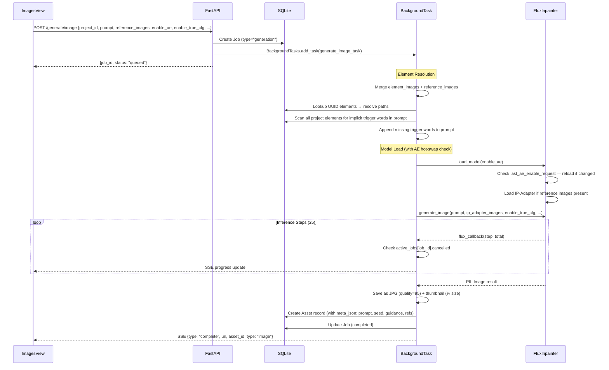
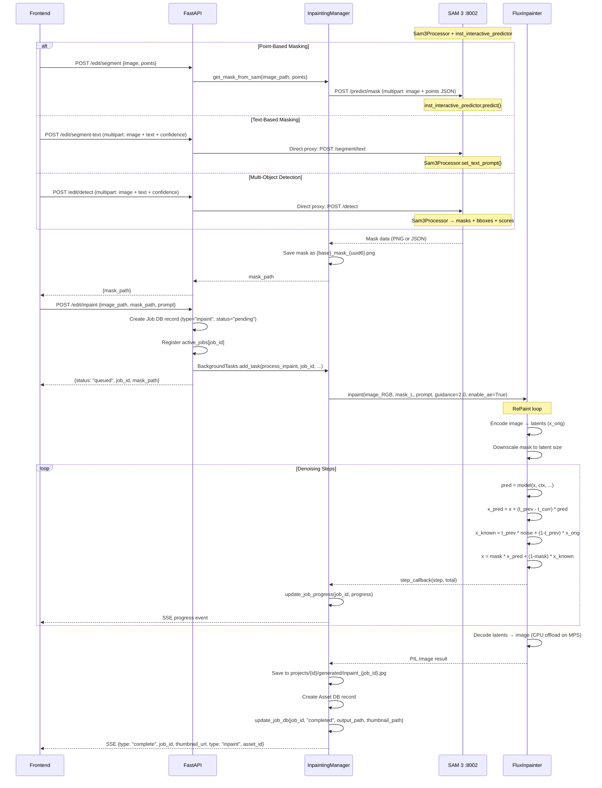
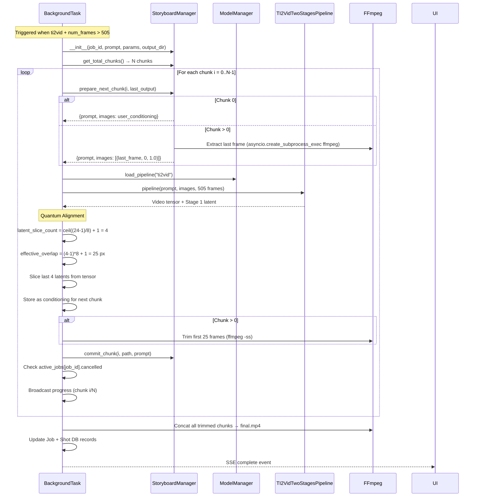
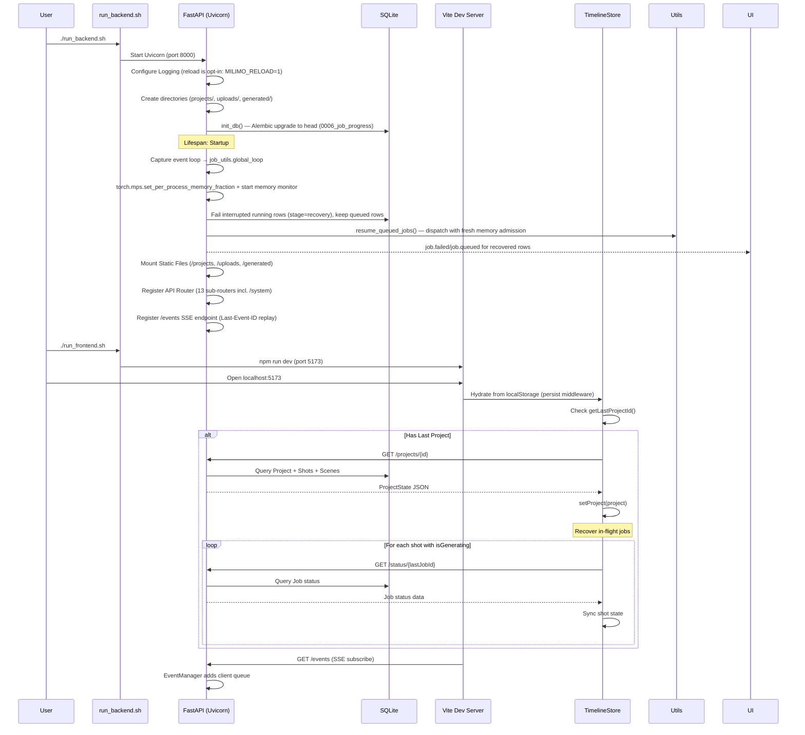
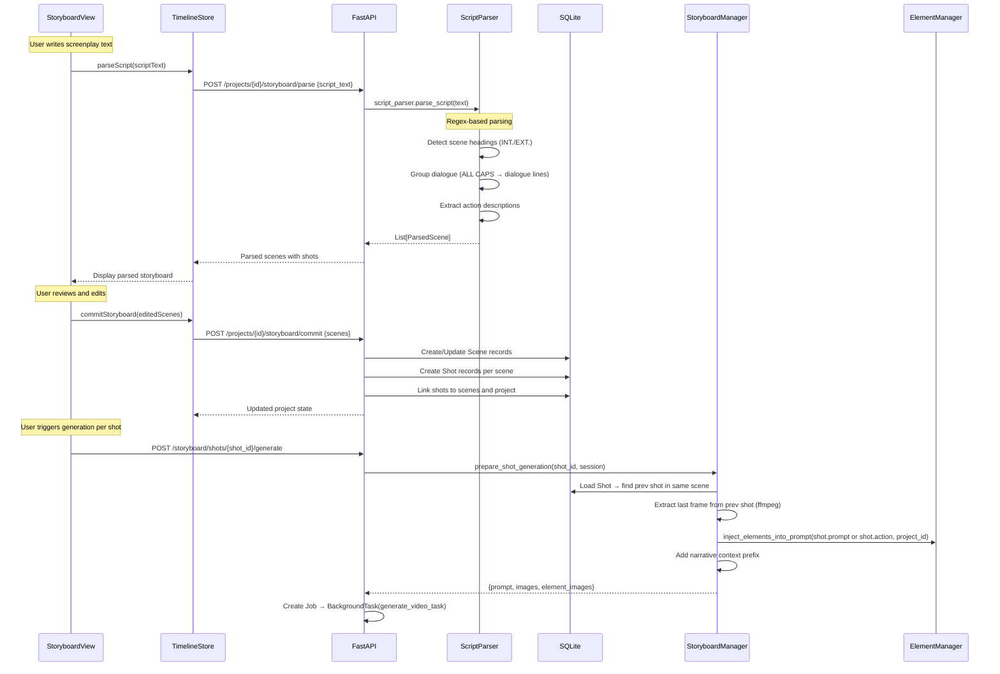
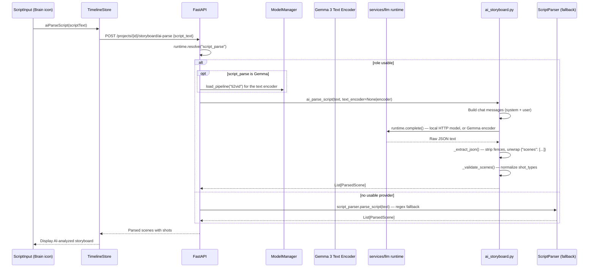
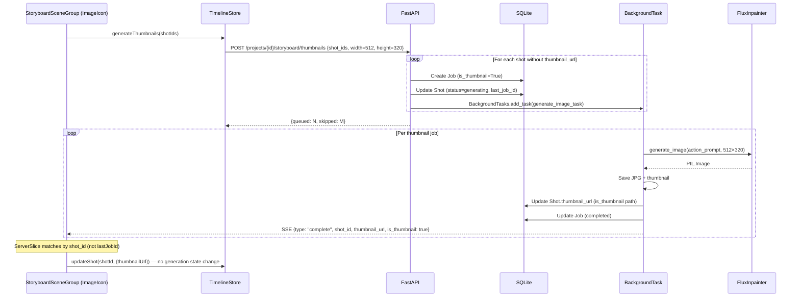
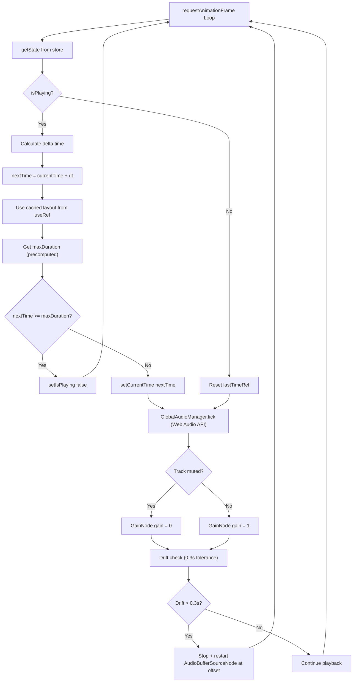

# Milimo Video — Execution Flow

> **Current implementation note (2026-11-18):** the sequence diagrams below show
> the pre-ledger shape and use the legacy `progress`/`complete` names. The live
> path now enqueues a `QueuedJob`, runs memory admission before the load, emits
> typed `job.*` events (with `seq`/replay), and terminates through one emitter.
> Read the diagrams for the pipeline internals; read §1/§5/§8 notes and
> [[systems/sse-eventing]] for the current control plane. Optional external
> engines (ComfyUI) run through the same ledger and never gate core generation.

## 1. Video Generation Sequence

```mermaid
sequenceDiagram
    participant UI as Frontend (React)
    participant Store as TimelineStore
    participant API as FastAPI Server
    participant DB as SQLite (SQLModel)
    participant Utils as job_utils
    participant Worker as BackgroundTask
    participant ME as ModelManager
    participant LTX as LTX-2 Pipeline
    participant FFmpeg as FFmpeg

    Note over UI: User clicks "Generate" in InspectorPanel
    
    UI->>Store: generateShot(shotId)
    Store->>Store: updateShot(id, {isGenerating: true})
    Store->>API: POST /generate/advanced {project_id, shot_config}

    API->>DB: Create Job (status=pending)
    API->>DB: Update Shot (status=generating, last_job_id)
    API->>Utils: enqueue_gpu_job → QueuedJob(status=queued)
    Utils-->>UI: job.queued {position, estimate_seconds}
    API-->>UI: Return 200 {job_id, status: "queued"}

    Note over UI: SSE connection already active

    Utils->>Utils: wait_for_turn (priority, resident slot, FIFO)
    Utils->>DB: QueuedJob(status=running), Job(stage=starting)
    Utils-->>UI: job.started
    Utils->>Worker: gpu_job_wrapper → generate_video_task
    Worker->>Worker: memory_manager.admit_job (defer/downgrade/refuse)
    Worker->>Utils: update_job_progress(stage=loading)
    Utils-->>UI: job.stage {stage: "loading", progress: 2}
    UI->>Store: handleServerEvent("progress", data)
    Store->>Store: updateShot(shotId, {progress: 0, statusMessage: "Loading models..."})

    Note over Worker: Pipeline Selection
    Worker->>Worker: Auto-detect pipeline type (ti2vid / ic_lora / keyframe)
    Worker->>Worker: Check num_frames == 1 → delegate to Flux 2 (skip LTX)
    Worker->>Worker: Check num_frames > 505 → delegate to chained gen

    Note over Worker: HTTP prompt role (before the pipeline loads)
    Worker->>Worker: Resolve prompt_video/prompt_image; if not Gemma, enhance now
    Worker->>Utils: update_job_db(enhanced_prompt), release local LLM models

    Worker->>ME: load_pipeline("ti2vid", loras)
    ME->>ME: Unload previous pipeline (gc + cache clear), drop llm_http
    ME->>LTX: TI2VidTwoStagesPipeline(checkpoint, ...)
    ME->>ME: MPS fix: force VAE to float32
    ME-->>Worker: Pipeline ready

    Note over Worker: In-pipeline enhancement (Gemma role only)
    Worker->>Worker: llm.enhance_prompt(prompt, text_encoder, image_path)
    Worker->>Utils: update_job_db(enhanced_prompt), release local LLM models
    Worker->>Utils: broadcast_progress(job_id, 5, enhanced_prompt)
    Utils-->>UI: SSE event: {type: "progress", enhanced_prompt: "..."}

    Note over Worker: Image Conditioning (if timeline items present)
    Worker->>Worker: Resolve image paths (URL decode, project path join)
    Worker->>Worker: Load & encode conditioning images via VAE

    Note over Worker: Run Pipeline
    Worker->>LTX: pipeline(prompt, images, num_frames, ...)
    
    loop Denoising Steps (8 distilled / 40 base)
        LTX->>LTX: Step N
        LTX-->>Worker: step_callback(step, total)
        Worker->>Utils: Check active_jobs[job_id].cancelled
        alt Cancelled
            Worker->>Utils: update_job_db(job_id, "cancelled")
            Worker-->>Utils: broadcast_progress(status="cancelled")
        end
        Worker->>Utils: update_job_progress(stage, step, total, eta)
        Utils-->>UI: job.stage / job.progress
    end

    LTX-->>Worker: Return video tensor

    Worker->>FFmpeg: encode_video(tensor, output_path) — libx264 + yuv420p + movflags faststart
    Note over Worker: encode runs in a worker thread; decoded buffers/caches are released after
    Worker->>FFmpeg: Asynchronous generate_thumbnail(video_path)
    Worker->>Utils: update_job_db(job_id, "completed", output_path, thumbnail_path)
    Worker->>Utils: update_shot_db(shot_id, {video_url, thumbnail_url, status: "completed"})
    Worker->>Utils: broadcast_progress(job_id, 100, "completed", video_url, thumbnail_url)
    
    Utils-->>UI: SSE event: {type: "complete", job_id, video_url, thumbnail_url}
    UI->>Store: handleServerEvent("complete", data)
    Store->>Store: updateShot(shotId, {isGenerating: false, videoUrl, thumbnailUrl, progress: 100})
    Store->>Store: triggerAssetRefresh()

    UI->>API: GET /projects/{id}/generated/{job_id}.mp4
    UI->>UI: CinematicPlayer loads video
```

## 2. Image Generation Sequence



## 3. Inpainting Sequence



## 4. Chained Generation Sequence



## 5. Startup Sequence



## 6. Storyboard Flow



### 6.1 AI Script Analysis Flow



### 6.2 Concept Art Thumbnail Flow



## 7. Project Save/Load Flow

```mermaid
flowchart TD
    subgraph "Save Flow"
        S1[User action triggers auto-save] --> S2[saveProject in ProjectSlice]
        S2 --> S3[PUT /projects/id/save]
        S3 --> S4[Upsert Project in DB]
        S3 --> S5[Sync Shots — Create/Update/Delete]
        S3 --> S6[Sync Scenes — Create/Update/Delete]
        S5 --> S7[Return updated ProjectState]
    end

    subgraph "Load Flow"
        L1[loadProject in ProjectSlice] --> L2[GET /projects/id]
        L2 --> L3[Query Project + Shots + Scenes from DB]
        L3 --> L4[Map camelCase for frontend]
        L4 --> L5[setProject in store]
        L5 --> L6[fetchElements for project]
        L5 --> L7[Save project_id to localStorage]
    end

    subgraph "Auto-Save Hook"
        AS1[useAutoSave in VisualTimeline] --> AS2{Project changed?}
        AS2 -->|Yes| AS3[Debounce 2 seconds]
        AS3 --> AS4[Call saveProject]
        AS2 -->|No| AS5[Skip]
    end
```



## 8. Cancellation Flow

```mermaid
sequenceDiagram
    participant UI as React Frontend
    participant API as FastAPI
    participant Utils as job_utils
    participant Worker as BackgroundTask

    UI->>API: POST /jobs/{job_id}/cancel
    alt Job is active
        API->>Utils: active_jobs[job_id]["cancelled"] = True
        API-->>UI: job.cancelling {stage: "cancelling"}
        Note over Worker: Next denoise/upscale step
        Worker->>Worker: Raise RuntimeError("Cancelled") to escape loop
        Worker->>Utils: job_events.terminal("cancelled")
        API-->>UI: job.cancelled (exactly once)
    else Job is queued/pending
        API->>DB: Job(status=cancelled, completed_at), QueuedJob(status=cancelled)
        API-->>UI: job.cancelled {message: "Cancelled before start"}
    end
    Note over UI: jobBridge clears the spinner; a 5 s /status watchdog is the fallback

    Note over API: Server Shutdown Fallback
    API->>Utils: cancel_all_jobs() — flags all active maps
    API->>API: await asyncio.sleep(2.0) — allows threads to escape
```

## 9. Playback Engine Loop



> **Note:** `computeTimelineLayout` is cached in a `useRef` and only recomputed when `project.shots` changes, not every animation frame. Audio uses `AudioContext` + `AudioBufferSourceNode` (Web Audio API) instead of `HTMLAudioElement` for reliable Safari playback.
